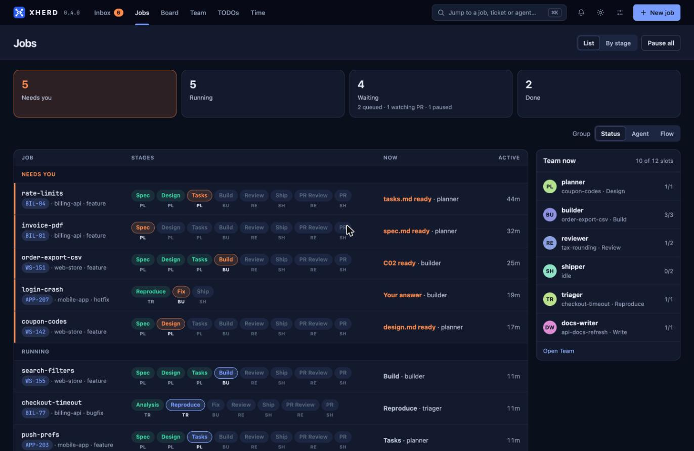
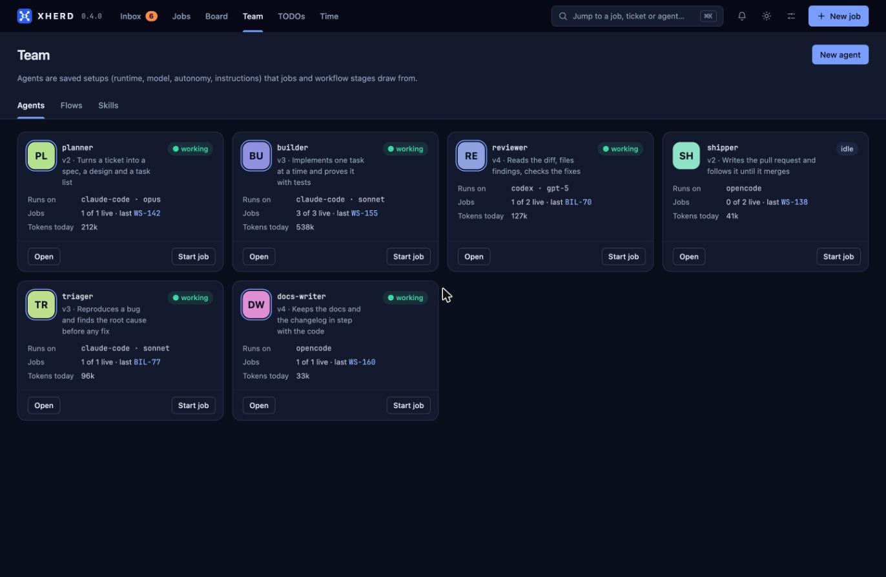

  

<h1 align="center">xherd</h1>

<b>Run a herd of coding agents in parallel. Stay in control.</b>

> [!WARNING]
> **Early releases (0.x).** xherd is under active development. Expect breaking changes between versions, missing features and rough edges, and back up anything you care about (`xherd backup create`) before updating.

## Why

I got overwhelmed running several coding tasks at once: terminals piled up and a job could wait an hour for an answer I never saw. The tools I tried each solved part of it, so I built the one I wanted, with the same kind of jobs it now manages. It is opinionated and built around my workflow; I hope it fits yours.

## What is xherd?

https://github.com/user-attachments/assets/90958349-cb23-4cae-8a91-4de39a15c95e

*A short tour with mocked data: a team of agents, the Jobs page with a pill per stage, the Team and its flows, the Inbox, a live terminal, a design with a diagram, comments on diff lines, approving a commit and resolving merge conflicts. More screens and the CLI: [the tour](doc/user/tour.md).*

You hand xherd your tickets. It gives each one to a coding agent in its own sandbox, and shows you all of them on one screen.

- **One ticket, one sandbox.** Each task gets its own git worktree and tmux session, so jobs never step on each other or on your checkout.
- **One screen for the herd.** The browser shows what every job is doing and which ones are waiting for you.
- **You approve the important steps.** Jobs follow a spec-driven flow (spec, design, tasks, commits, pull request) and stop at gates. You read what they propose, then approve or ask for changes.
- **Bring your own job and process.** Claude Code, opencode or Codex; the runtime, the flow and the integrations are plugins.
- **Docker or native.** Docker keeps jobs and toolchains in a container and shares only your workspace; you can still open the code in your IDE.

> **Status: early, but it runs.** Jobs work end to end (worktree, runtime in tmux, approval gates, commits, draft PR, PR follow-up), with a web UI, a Docker image and Linux packages ([releases](https://github.com/xionjames/xherd/releases)). It is a single-user tool for now, and the planned items below are not built yet. See the [roadmap](ROADMAP.md) and open an issue with feedback.

## Features

### Jobs

- Many jobs in parallel, each in its own git worktree, branch and tmux session, with a concurrency cap.
- Claude Code, opencode or Codex, chosen per job, with a model per job and a tool-permission mode (ask, edits, auto, all).
- Named jobs with an optional ticket (an issue URL or key) that prefixes the branch; repositories by path or cloned by URL.
- A live terminal per job in the browser. **Ask** gives a stopped job a quick session with your question, held until you finish it.
- Pause with a handoff note, resume where the conversation left off, and "Pause all" as a kill switch.
- Jobs survive restarts: parked at their gate or resumed, not lost.

### Review and approval

- A spec-driven flow built in (spec, design, tasks, implement, review, ship), defined as a flow pack whose prompts you can edit.
- Every step stops at a gate. Documents render Markdown with Mermaid diagrams; comment on any block or diff line and send it all back as one change request.
- Approvals are hashed, so you approve exactly what you read. xherd makes the approved commit itself.
- Each step starts a fresh session that carries over a short `memory.md`; the coding agent can propose updates to the repo's shared `AGENTS.md`.

### Pull requests

- Approving the ship gate has the job push and open a draft PR. xherd itself never pushes.
- The PR's checks, conflicts and reviewers are polled, or checked at once with *Check now*.
- Review comments become a round: the coding agent proposes fix, reply or skip per comment, you decide, replies are posted only after you approve.
- **Resolve conflicts** has the job merge the base branch (never a rebase), and the merge commit always waits for you.
- GitHub and GitLab for pull requests; Bitbucket for git access only.

### Agents, flows and skills

- A **flow** is the list of stages a job goes through (the built-in pack has `feature` and `bugfix`). Give each stage to a saved **agent**: for example one agent writes the spec and the design, another builds, another reviews and ships. A job runs the agent of its current stage, in a fresh session.
- Save an agent once (runtime, model, autonomy, instructions, guardrails, skills, a memory) as a named, versioned persona, and start jobs from it in the UI, the CLI or the API.
- A job keeps a snapshot of its agents, so editing one never changes a running job; an agent's memory grows through proposals you accept. If an agent's runtime is switched off, its fallback runtime takes over.
- Skills are a library of reusable instructions that agents list; each job gets its own copy.
- xherd suggests saving a job's setup as an agent when you finish one, or when you start the same setup a third time.

### Autonomy and guardrails

- Adjustable autonomy: xherd can approve routine steps itself, and lists them for you to look over later.
- Tripwires hold a step for you: secrets in the diff, sensitive paths, large diffs, files outside the task's scope, failing lint or tests.
- A pre-push guard, token budgets per job and per day, a session time limit, a cap on automatic approvals in a row and on review rounds.
- In Docker, the daemon and the jobs run as different users, so jobs cannot read xherd's secrets.

### Your view of the work

- **Jobs**: four counters that filter, every job with a pill per stage and the agent that runs it, by list, by stage, or a view plugin of your own. A **Board** of every stage and task. An **Inbox** with everything that stops a job and what xherd approved for you. A **Team** page for agents, flows and skills.
- Notifications in the bell, the browser, the desktop (native installs) and on your phone through ntfy.
- Issue trackers (Jira, GitHub issues, GitLab issues): ticket keys become links, the ticket shows beside the job, and you can post a summary once the PR is open.
- Time tracking per ticket, and TODOs: reminders, or conditions a read-only job run checks for you.

### Setup and operation

- Docker-first: jobs, toolchains (Java, Node, Go, Rust, Python) and the agent CLIs live in one container; only your workspace is shared. Open the worktree in your IDE or your own terminal.
- Git access from the UI (HTTPS tokens, SSH keys, commit identity per repository owner) with a doctor that says what is wrong.
- Repo profiles: base branch, autonomy, tripwires, test and lint commands, instructions and defaults per repository.
- Backups of jobs and their work (`xherd backup create|verify|restore`), taken before every `xherd docker update`.
- Plugins in any language (the CLI is the plugin API). One Rust binary with the web UI embedded; most actions are also CLI commands.

### Planned

- A runtime, model and effort per step.
- Secure access from your phone or another device (binding beyond loopback, HTTPS and device pairing), beyond notifications.
- Dynamic job actions: buttons and commands that plugins, flow packs and profiles add to a job (run the app, open a preview, run a script).
- In Docker: file sharing with the job's terminal and port forwarding to a job's dev server.
- macOS binaries (Intel and Apple silicon) and a Homebrew tap.
- Board cards and views declared by flow packs and profiles.
- Your own spec-driven method under xherd, through your own flow pack or a few `xherd` calls ([draft guide](doc/extend/integrate-your-sdd.md)).

## Documentation

Start with **[Getting started](doc/user/getting-started.md)** (install with Docker or a Linux package, first job), then **[Using xherd](doc/user/guide.md)**. Everything else is in the [documentation index](doc/README.md):

| | |
|---|---|
| Running it | [Getting started](doc/user/getting-started.md) · [Tour](doc/user/tour.md) · [Using xherd](doc/user/guide.md) · [Docker](doc/user/docker.md) · [Security model](doc/user/security.md) |
| Reference | [CLI](doc/reference/cli.md) · [Configuration](doc/reference/configuration.md) · [HTTP API](doc/reference/http-api.md) · [XAP](doc/reference/xap.md) |
| Extending | [Plugins](doc/extend/plugins.md) · [Flow packs](doc/extend/flow-packs.md) · [Add xherd support to your SDD](doc/extend/integrate-your-sdd.md) |
| Contributing | [Running from source](doc/dev/from-source.md) · [Development](doc/dev/development.md) · [Architecture](doc/dev/architecture.md) · [Roadmap](ROADMAP.md) |

## License

[GPL-3.0-or-later](LICENSE)
