

  

<h1 align="center">xherd</h1>

<b>Run a herd of coding agents in parallel. Stay in control.</b>

> [!WARNING]
> **Development version.** xherd is under active development and has no releases yet. Expect breaking changes, missing features and rough edges, and back up anything you care about before trying it.

## Why

I got overwhelmed running several coding tasks at once: terminals piled up and an agent could wait an hour for an answer I never saw. The tools I tried each solved part of it, so I built the one I wanted, with the same kind of agents it now manages. It is opinionated and built around my workflow; I hope it fits yours.

## What is xherd?

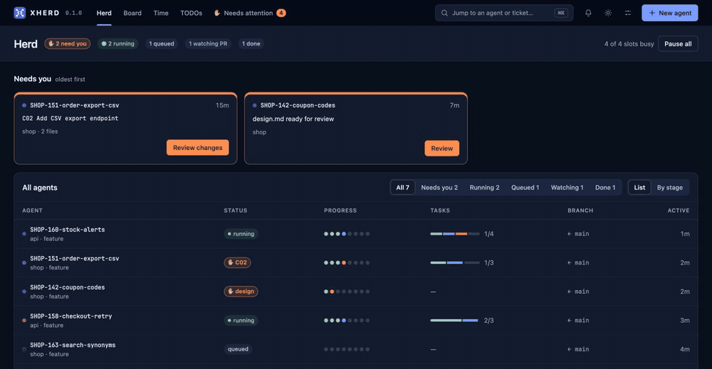
*A short tour, with mocked data. Stills of each screen are [below](#screenshots).*

You hand xherd your tickets. It gives each one to a coding agent in its own sandbox, and shows you all of them on one screen.

- **One ticket, one sandbox.** Each task gets its own git worktree and tmux session, so agents never step on each other or on your checkout.
- **One screen for the herd.** The browser shows what every agent is doing and which ones are waiting for you.
- **You approve the important steps.** Agents follow a spec-driven flow (spec, design, tasks, commits, pull request) and stop at gates. You read what they propose, then approve or ask for changes.
- **Bring your own agent and process.** Claude Code today; the runtime, the flow and the integrations are plugins.
- **Docker or native.** Docker keeps agents and toolchains in a container and shares only your workspace; you can still open the code in your IDE.

> **Status: early, but it runs.** One agent works end to end (worktree, Claude Code in tmux, approval gates, commits, draft PR), with a web UI and a Docker setup. It is a single-user tool for now, and the planned items below are not built yet. See the [roadmap](ROADMAP.md) and open an issue with feedback.

## Highlights

Working today:

- Many agents in parallel, each isolated in its own git worktree and tmux session, with a concurrency cap.
- A web UI: the herd at a glance, a "your call" band for whatever needs you, a live terminal per agent, diffs, and settings with setup checks.
- Approval gates for spec, design, tasks and commits; documents render Markdown with Mermaid diagrams, and you can comment on any block or diff line. Approvals are hashed, so you approve exactly what you read, and each step starts a fresh session that carries over a short `memory.md`.
- xherd runs the approved commit for you, and the agent opens a draft pull request when you approve the ship gate.
- Pluggable spec-driven development: **xherd** built in, or your own through flow packs or a few `xherd` calls ([guide](doc/integrate-your-sdd.md)).
- Docker-first: agents, toolchains (Java, Node, Go, Rust, Python) and Claude Code live in one container and only your workspace is shared. "Open in" your IDE through same-path mounts.
- Agents survive restarts: they are parked at their gate or resumed, not lost.
- Git access from the UI (HTTPS tokens, SSH keys, per-owner commit identity) and repositories cloned by URL.
- Plugins in any language (the CLI is the plugin API). Single Rust binary, web UI embedded.
- A Board with every stage and task of every agent (pending, in progress, done), a Needs attention page, time tracking and TODOs.
- Adjustable autonomy: xherd can approve routine steps itself, held back by tripwires (secrets, sensitive paths, large diffs, failing lint or tests). Guardrails: a pre-push guard, token budgets, a session time limit and a "Pause all" kill switch.
- Pull request follow-up: CI and merge conflicts are polled, review comments become fix tasks, and replies are posted only after you approve them.
- Repo profiles: per-repository base branch, autonomy, tripwires, test and lint commands, and instructions.
- Notifications in the browser and on the desktop, and on your phone through ntfy.
- Backups of agents and their work (`xherd backup create|verify|restore`).

Planned:

- Other runtimes beyond Claude Code (Codex, opencode…), and a runtime, model and effort per step.
- Secure access from your phone or another device (pairing), beyond notifications.
- Declarative views: Board cards and views declared by flow packs and profiles.

## Screenshots

All with mocked data.

| | |
|---|---|
| 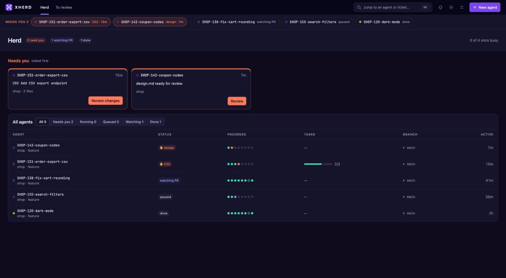 | 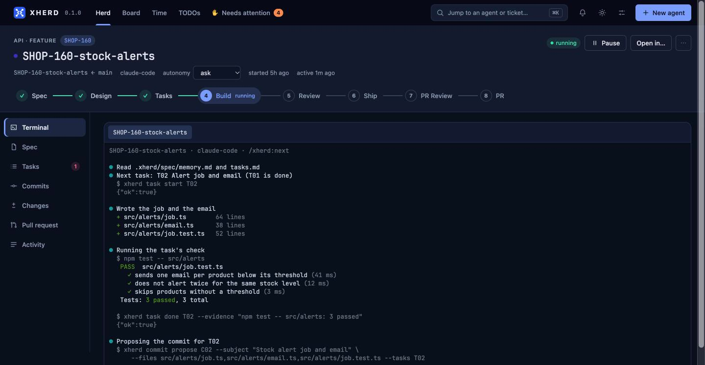 |
| **Herd.** What needs you on top, every agent below. | **Terminal.** Each agent's live session, in the browser. |
| 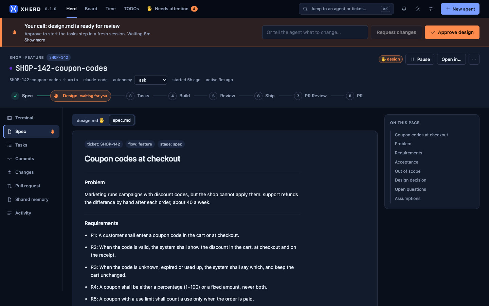 | 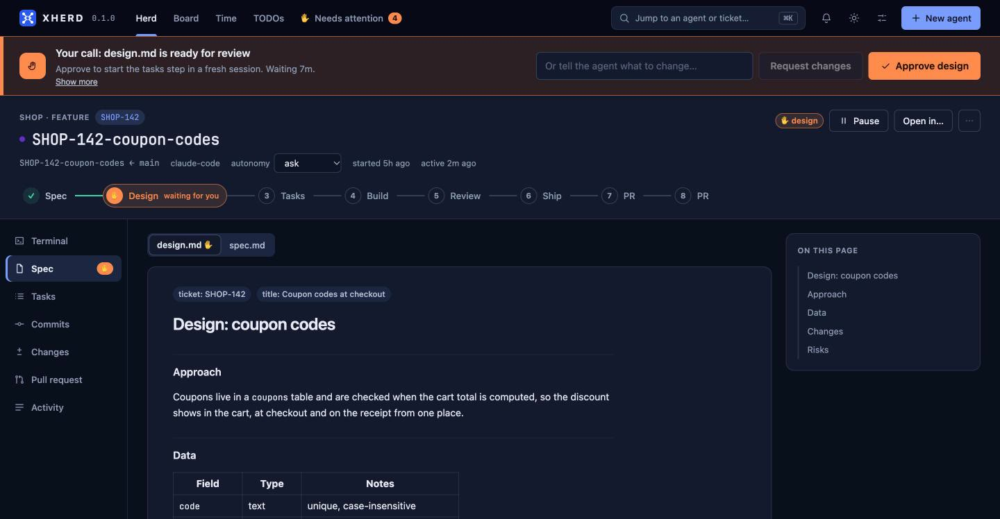 |
| **Spec.** Problem, requirements and acceptance, written by the agent. | **Review a document.** Approve it, or ask for changes. |
| 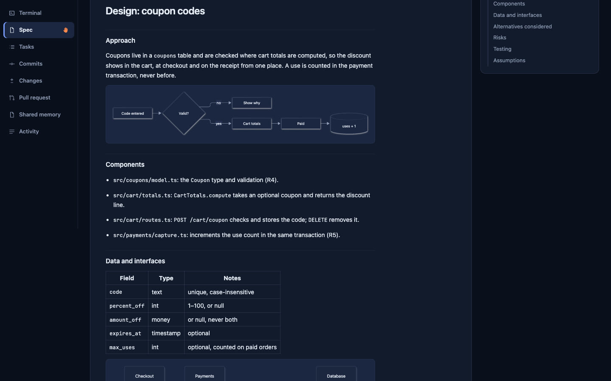 | 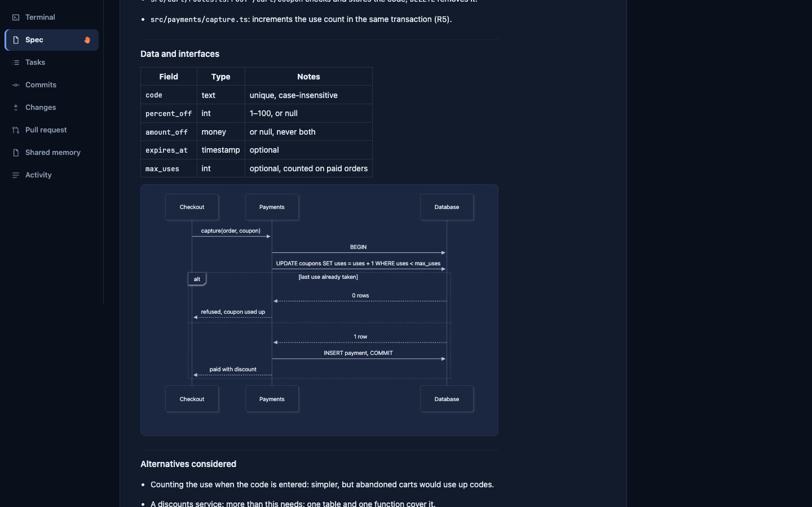 |
| **Design.** Diagrams in the documents are drawn ([Mermaid](https://mermaid.js.org)). | **Design.** Data, interfaces and the tricky parts, as diagrams. |
| 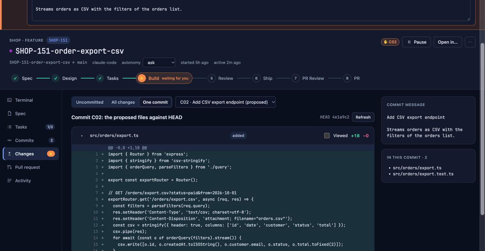 | 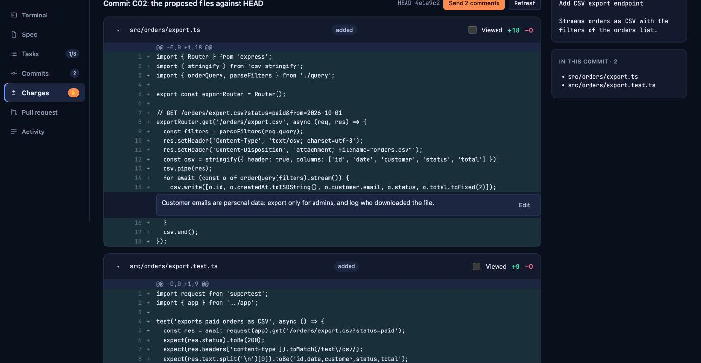 |
| **Review a commit.** xherd commits it when you approve. | **Comment on lines.** Comments go back to the agent as one change request. |
| 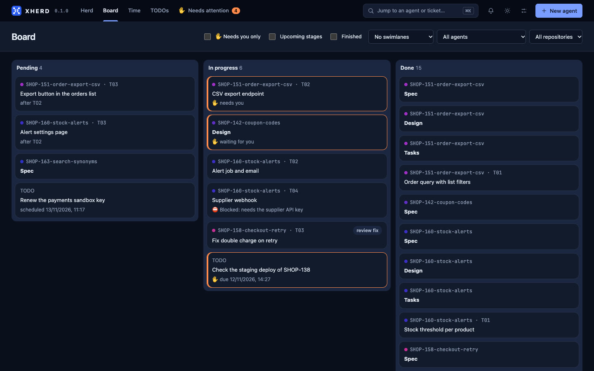 | 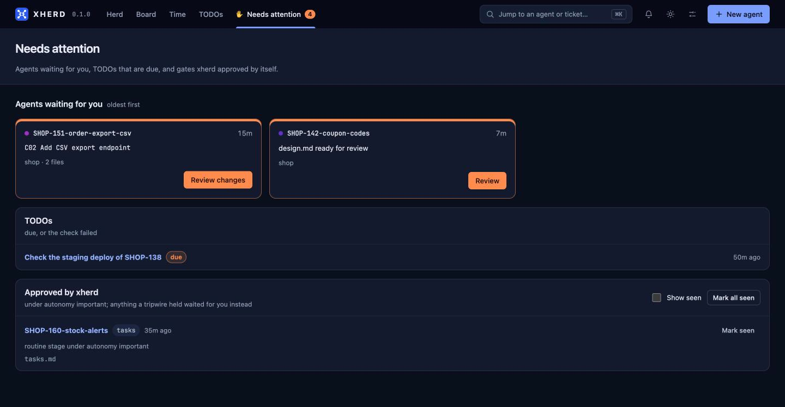 |
| **Board.** Every stage and task of every agent, and your TODOs. | **Needs attention.** Everything waiting on you in one place. |

## Documentation

- [Getting started](doc/getting-started.md): install a release (Docker recommended), first agent, everyday commands
- [Running from source](doc/from-source.md): build the image or the binary from this repository
- [Docker](doc/docker.md): topology, the two-user container, git access, toolchains, operating
- [Architecture](doc/architecture.md): crates, actors, gates, sessions, plugins, guardrails
- [CLI reference](doc/cli.md) and [Configuration](doc/configuration.md)
- [Security model](doc/security.md)
- [Plugins and flow packs](doc/plugins-and-packs.md): extending xherd
- [Development](doc/development.md): build, test, conventions, how to add things
- [XAP reference](doc/xap.md): the protocol agents and SDDs use to talk to xherd
- [Add xherd support to your SDD](doc/integrate-your-sdd.md)
- [Roadmap](ROADMAP.md)

Working documents, to be removed when the final documentation is complete: [Product specification](doc/spec.md) and [Design](doc/design.md).

## License

[MIT](LICENSE)
