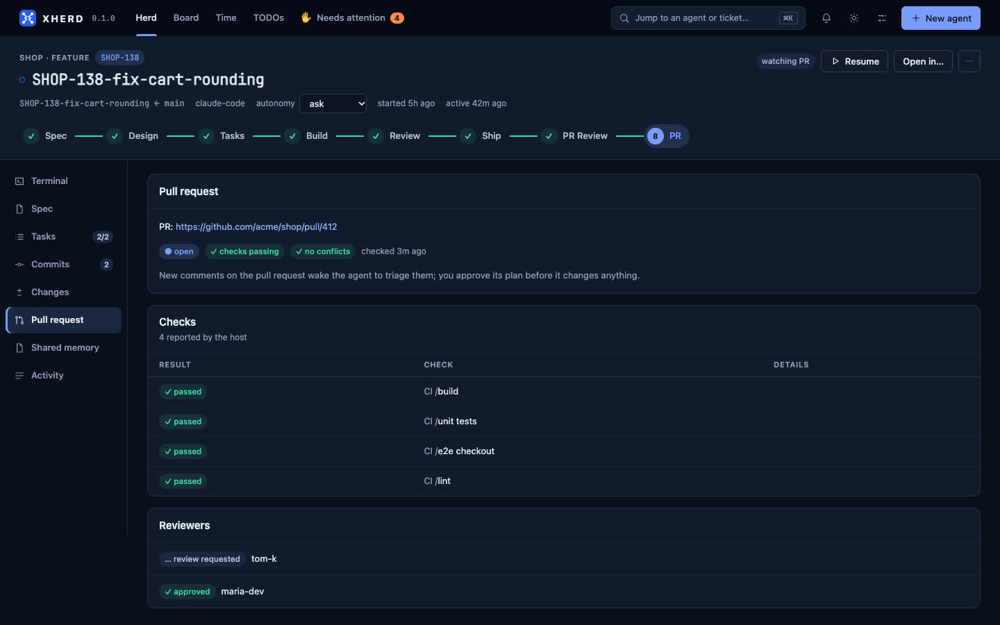
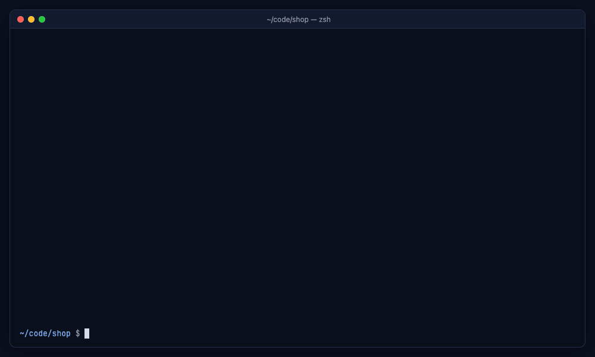

  

<h1 align="center">xherd</h1>

<b>Run a herd of coding agents in parallel. Stay in control.</b>

> [!WARNING]
> **Early releases (0.x).** xherd is under active development. Expect breaking changes between versions, missing features and rough edges, and back up anything you care about (`xherd backup create`) before updating.

## Why

I got overwhelmed running several coding tasks at once: terminals piled up and an agent could wait an hour for an answer I never saw. The tools I tried each solved part of it, so I built the one I wanted, with the same kind of agents it now manages. It is opinionated and built around my workflow; I hope it fits yours.

## What is xherd?

*A short tour, with mocked data. Stills of each screen and the CLI are [below](#screenshots).*

You hand xherd your tickets. It gives each one to a coding agent in its own sandbox, and shows you all of them on one screen.

- **One ticket, one sandbox.** Each task gets its own git worktree and tmux session, so agents never step on each other or on your checkout.
- **One screen for the herd.** The browser shows what every agent is doing and which ones are waiting for you.
- **You approve the important steps.** Agents follow a spec-driven flow (spec, design, tasks, commits, pull request) and stop at gates. You read what they propose, then approve or ask for changes.
- **Bring your own agent and process.** Claude Code, opencode or Codex; the runtime, the flow and the integrations are plugins.
- **Docker or native.** Docker keeps agents and toolchains in a container and shares only your workspace; you can still open the code in your IDE.

> **Status: early, but it runs.** Agents work end to end (worktree, runtime in tmux, approval gates, commits, draft PR, PR follow-up), with a web UI, a Docker image and Linux packages ([releases](https://github.com/xionjames/xherd/releases)). It is a single-user tool for now, and the planned items below are not built yet. See the [roadmap](ROADMAP.md) and open an issue with feedback.

## Highlights

Working today:

- Many agents in parallel, each isolated in its own git worktree and tmux session, with a concurrency cap.
- A web UI: the herd at a glance, a "your call" band for whatever needs you, a live terminal per agent, diffs, and settings with setup checks.
- Approval gates for spec, design, tasks and commits; documents render Markdown with Mermaid diagrams, and you can comment on any block or diff line. Approvals are hashed, so you approve exactly what you read, and each step starts a fresh session that carries over a short `memory.md`.
- xherd runs the approved commit for you, and the agent opens a draft pull request when you approve the ship gate.
- A spec-driven flow built in (**xherd**: spec, design, tasks, implement, review, ship), defined as a flow pack whose prompts you can edit.
- Docker-first: agents, toolchains (Java, Node, Go, Rust, Python) and Claude Code live in one container and only your workspace is shared. "Open in" your IDE through same-path mounts.
- Agents survive restarts: they are parked at their gate or resumed, not lost.
- Git access from the UI (HTTPS tokens, SSH keys, per-owner commit identity) and repositories cloned by URL. GitHub and GitLab for pull requests; Bitbucket for git access.
- Issue trackers (Jira, GitHub issues, GitLab issues): ticket keys become links, the ticket and its comments show beside the agent, and you can post a summary of the work when the PR is open.
- Plugins in any language (the CLI is the plugin API). Single Rust binary, web UI embedded.
- A Board with every stage and task of every agent (pending, in progress, done), a Needs attention page, time tracking and TODOs.
- Adjustable autonomy: xherd can approve routine steps itself, held back by tripwires (secrets, sensitive paths, large diffs, failing lint or tests). Guardrails: a pre-push guard, token budgets, a session time limit and a "Pause all" kill switch.
- Pull request follow-up: CI and merge conflicts are polled, review comments become fix tasks, and replies are posted only after you approve them.
- Repo profiles: per-repository base branch, autonomy, tripwires, test and lint commands, and instructions.
- Notifications in the browser and on the desktop, and on your phone through ntfy.
- Backups of agents and their work (`xherd backup create|verify|restore`).

Planned:

- A runtime, model and effort per step (the runtimes today: Claude Code, opencode, Codex).
- Secure access from your phone or another device (pairing), beyond notifications.
- Declarative views: Board cards and views declared by flow packs and profiles.
- Your own spec-driven method under xherd, through your own flow pack or a few `xherd` calls ([draft guide](doc/extend/integrate-your-sdd.md)).

## Screenshots

All with mocked data.

| | |
|---|---|
|  |  |
| **Herd.** What needs you on top, every agent below. | **Terminal.** Each agent's live session, in the browser. |
|  |  |
| **Spec.** Problem, requirements and acceptance, written by the agent. | **Review a document.** Approve it, or ask for changes. |
|  |  |
| **Design.** Diagrams in the documents are drawn ([Mermaid](https://mermaid.js.org)). | **Design.** Data, interfaces and the tricky parts, as diagrams. |
|  |  |
| **Review a commit.** xherd commits it when you approve. | **Comment on lines.** Comments go back to the agent as one change request. |
|  |  |
| **Board.** Every stage and task of every agent, and your TODOs. | **Needs attention.** Everything waiting on you in one place. |
|  | |
| **Pull request.** Checks, conflicts and reviewers, polled while the agent watches it. | |

### From the terminal

*The everyday actions are also commands: `xherd ls`, `new`, `diff`, `approve`, `changes`, `pause` (the outputs are real, from a throwaway daemon). See the [CLI reference](doc/reference/cli.md).*

## Documentation

Start with **[Getting started](doc/user/getting-started.md)** (install with Docker or a Linux package, first agent), then **[Using xherd](doc/user/guide.md)**. Everything else is in the [documentation index](doc/README.md):

| | |
|---|---|
| Running it | [Getting started](doc/user/getting-started.md) · [Using xherd](doc/user/guide.md) · [Docker](doc/user/docker.md) · [Security model](doc/user/security.md) |
| Reference | [CLI](doc/reference/cli.md) · [Configuration](doc/reference/configuration.md) · [HTTP API](doc/reference/http-api.md) · [XAP](doc/reference/xap.md) |
| Extending | [Plugins](doc/extend/plugins.md) · [Flow packs](doc/extend/flow-packs.md) · [Add xherd support to your SDD](doc/extend/integrate-your-sdd.md) |
| Contributing | [Running from source](doc/dev/from-source.md) · [Development](doc/dev/development.md) · [Architecture](doc/dev/architecture.md) · [Roadmap](ROADMAP.md) |

## License

[MIT](LICENSE)
