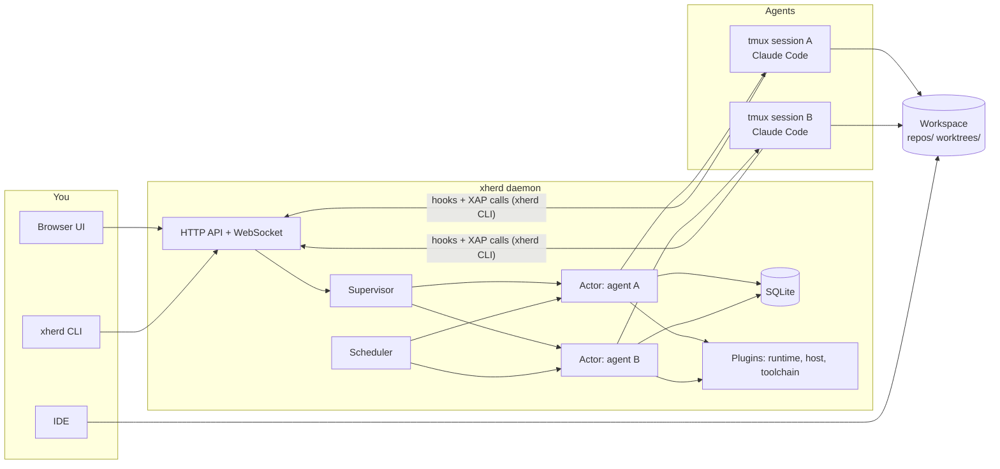
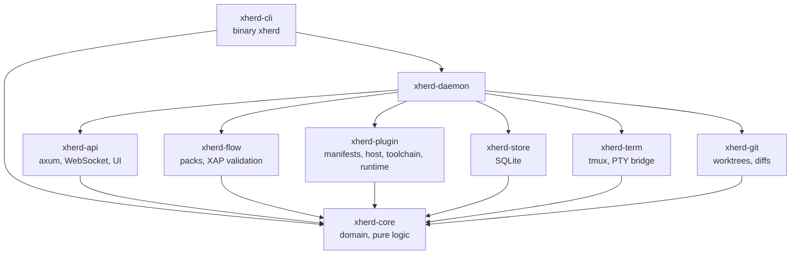
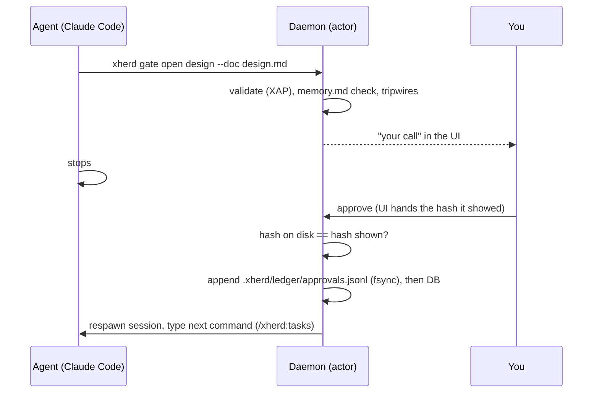
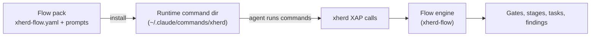

# Architecture

xherd is one Rust daemon with an embedded web UI. It keeps one **actor** per agent, runs each agent's coding runtime inside a **tmux** session in its own **git worktree**, and stops it at **approval gates**. This page explains the pieces and how they talk. For the agent-side protocol see [XAP](../reference/xap.md).

## Big picture



Two channels connect the daemon and an agent:

- **Down:** the daemon starts the runtime in tmux and types commands into it (the flow's next step, your messages, approvals).
- **Up:** the runtime's hooks and the agent's own `xherd …` calls (XAP) reach the daemon over HTTP. They say what the agent is doing and declare gates. The daemon never parses the agent's prose.

## Crates



| Crate | Responsibility |
|---|---|
| `xherd-core` | Domain types and pure logic: `Status` and its lifecycle table, `Agent`, reports, gates, tasks, commits, autonomy policy, secret tripwire, pre-push guard rules, config, content hashing, the only way to run external commands (`exec::run`). No I/O of its own; heavily tested, including property tests. |
| `xherd-store` | SQLite (WAL, one writer thread, read-only pool), forward-only migrations. |
| `xherd-flow` | Flow packs (`xherd-flow.yaml`), template rendering, `tasks.md` and `review.md` parsers, the pure XAP validation (`xap::apply`), pack installation. The built-in pack is embedded from `packs/xherd/`. |
| `xherd-plugin` | Plugin manifests and registry, the command protocol, and the Rust side of the built-in plugins: runtimes (Claude Code, opencode, Codex), hosts (`gh` for GitHub, `glab api` for GitLab), trackers (issue reading and posting, Jira's document format), git providers, toolchains. |
| `xherd-term` | tmux wrapper and the PTY bridge behind the browser terminal. |
| `xherd-git` | Worktrees, diffs of proposed files, commits, bundles, the push guard. |
| `xherd-api` | axum routes under `/api/v1`, `/ws` change feed, terminal websockets, authentication, the embedded UI. |
| `xherd-daemon` | Supervisor, actors, scheduler, agent creation, pack install, settings, git access, repo profiles, TODOs and condition checks, the work log, notifications (bell, ntfy, desktop), backups, Open in, the runner client, the glue. |
| `xherd-cli` | The `xherd` binary: daemon, container entrypoint (`init`) and `runner`, Docker commands, user commands, backups, runtime hooks, XAP calls, credential helper, pre-push guard, toolchain launcher, the Open-in companion. |

## One actor per agent

Each agent is a tokio task that owns its `Agent` value and reads a mailbox. Everything that can change an agent is a message:

```rust
enum Msg {
    Report(Report),       // runtime hook / `xherd report`, with a sequence number
    Xap(XapCall, ..),     // an agent's `xherd gate open`, `task done`, ...
    User(UserAction, ..), // approve, pause, send, ...
    Tick(TickKind),       // scheduler
    WorkDone { generation, result }, // spawned work coming back
}
```

The actor applies a message with a **pure function** from `xherd-core`, persists through the store's writer, and publishes a change to the WebSocket hub. Slow work (host lookups, PR polling, usage measurement) runs in spawned tasks and returns as `WorkDone` tagged with the agent's `generation`. A result whose generation is stale is dropped, which covers "the gate changed while we were checking".

A **supervisor** owns the registry, the concurrency cap and the start queue. A **scheduler** owns the periodic jobs (screen scan, session reconcile, PR poll, idle alerts, parking, session limit, TODO due times, work log, retention) and only sends messages.

Settings that apply live reach actors through a shared snapshot (`SettingsHandle`) that is rebuilt when the configuration is saved; each use takes the snapshot once.

Reports carry a sequence number; one older than the last applied is ignored, so a replayed hook cannot move an agent backwards.

## Approval gates



- A document is approved if and only if its current content hash has a ledger entry. Hashes ignore CRLF differences, and in `tasks.md` the `status:`/`evidence:` lines, so progress does not re-open the gate.
- Editing an approved document re-opens its gate; the UI shows what changed since you last read it.
- A commit gate approves exactly the proposed files. **xherd makes the commit itself** (hooks run, never `--no-verify`); the agent only records the sha.
- Autonomy can approve a gate for you when its class allows it and no tripwire holds it; those approvals are marked `auto` in the ledger and listed for review.

## Sessions and memory

Approving a gate starts a **fresh runtime session** (`freshSessions`, on by default). The tmux session and its environment survive; only the agent window's process is respawned, and the next command is typed once the runtime's `session-start` hook arrives. What carries over is `.xherd/spec/memory.md` (State, Decisions, Code map, Watch out), which every step reads first and rewrites before its gate. The daemon refuses a gate or commit proposal whose `memory.md` is missing or malformed.

After a daemon or container restart the daemon reconciles with tmux: an agent waiting at a gate is *parked* (approving still works), any other live agent is resumed through the pack's `resume` command, continuing the runtime's own conversation when its transcript can be found.

## Flow packs and plugins



- A **flow pack** is data: the stage graph (role, class, gate documents, next command), command prompts, and document formats. The daemon needs only the graph and the gate files; prose belongs to the agent. xherd ships its own pack and cannot load another yet; running your own SDD through a few XAP calls (dynamic flows) or its own pack is planned ([draft guide](../extend/integrate-your-sdd.md)).
- **Plugins** have a manifest (`xherd-plugin.json`) and run commands through a small protocol, so they can be written in any language. Kinds: *runtime* (how to launch and read the agent CLI: Claude Code, opencode, Codex), *host* (git access and pull requests: GitHub, GitLab, Bitbucket), *tracker* (ticket links, reading a ticket, posting a summary: Jira, GitHub issues, GitLab issues), *toolchain* (SDKMAN, nvm, uv, Go, rustup: version files to installed tools). Built-ins are embedded; external plugins override them. Each agent's runtime is fixed at creation, and its host plugin is picked by its remote's host. See [Plugins](../extend/plugins.md) and [Flow packs](../extend/flow-packs.md).

## Git and security guardrails

- **Worktrees**: `<workspace>/worktrees/<repo>/<agent>`, created with `--no-track`. `.xherd/` inside each worktree is excluded through the repository's shared `info/exclude`.
- **Pre-push guard**: each worktree gets its own `core.hooksPath` with a `pre-push` that calls `xherd guard pre-push`. It stops mistakes; branch protection on the host is the real boundary (`git push --no-verify` skips it).
- **Tripwires** on commit proposals: secret patterns, sensitive path globs, diff size, and the scope fence (`files:` of the listed tasks). A hit sets *needs human* on the gate.
- **Untrusted text**: PR comments reach the agent wrapped in `<<<xherd-untrusted TOKEN …>>>` blocks with a random per-message token. Replies built from them are posted only after a human-only approval. Ticket text is only shown to the user, through an allow-list sanitiser.
- **Budgets and limits**: per-agent and per-day token budgets, a session length limit, a review loop limit, a run limit of consecutive auto-approvals.
- **Authentication**: tokens with scopes (`hooks`, `xap`, `credential` for agents; a user token for the CLI). Local browsers get full rights by address and a local `Origin`; requests from another site are refused. Routes and auth rules: [HTTP API](../reference/http-api.md).

## Storage

SQLite in WAL mode holds agents (JSON documents), events, approvals, reviewed snapshots, "viewed" marks, installs, budgets, tokens, repo profiles, TODOs and the work log. Migrations are forward-only and the database is copied (`VACUUM INTO`) before migrating. Files in the data root: `config.json` (atomic writes), `secrets.json` (mode 0600), `hook-queue.jsonl` (hooks sent while the daemon was unreachable; replayed at start and every minute). Per agent, in the worktree: `.xherd/agent.json`, `instructions.md`, `spec/` documents, `ledger/approvals.jsonl`.

## In the container

`xherd init` (the entrypoint, as root) creates two users and drops privileges. The daemon runs as `xherd-daemon` with its data in its own volume; a `xherd runner` process runs as the agents' user (your host ids), keeps the tmux server, and runs on the daemon's behalf everything that must happen as that user: git, `verify:` and tripwire commands, plugin commands and checks, reading transcripts, writing the runtime's trust and hook files. Without a runner (native installs, tests) the same calls act in place. Each worktree's `.xherd/` is shared between the two users through group permissions. Details: [Docker](../user/docker.md#two-users-inside-the-container).

## Execution rules

All external commands go through `xherd_core::exec::run`: argv only (no shell), timeout with process-group kill, environment allowlist, output cap, secret redaction. The few exceptions (the interactive terminal client, processes that replace the CLI such as `toolchain exec`, long-lived helpers) are listed in [Development](development.md#conventions).
