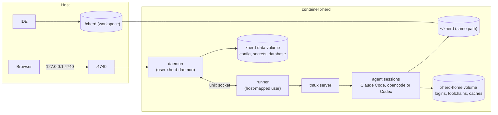

# Docker

Docker is the recommended way to run xherd. The daemon, the web UI, tmux, Claude Code, opencode, Codex, `git`, `gh`, `glab` and the toolchain managers all live in one container. Only your workspace folder is shared with the host, so agents cannot reach the rest of your files.

## Topology

| Volume / mount | Holds | Who can write |
|---|---|---|
| `${XHERD_WORKSPACE}` mounted at the **same path** | `repos/`, `worktrees/` | Agents (as your user id) and you |
| `xherd-home` at `/home/xherd` | Runtime logins, installed toolchains, caches | The agents' user |
| `xherd-data` at `/var/lib/xherd-daemon` | `config.json`, `secrets.json`, the database | The daemon's user only |

### Why the same path

A git worktree stores absolute paths in its `.git` file and in the main repository's `.git/worktrees/<name>/gitdir`. Mounting the workspace at the identical path keeps those pointers valid on the host and in the container, and every path shown in the UI works in your IDE.

Repositories outside the workspace are refused with a message telling you to clone into the workspace.

## Two users inside the container

`xherd init` (the entrypoint, the only root process) creates two unprivileged users and starts everything under `tini`:

- **Agents' user**: the same ids as your host user (`XHERD_UID`/`XHERD_GID`), so files agents write are yours. Runs Claude Code, opencode or Codex, git and your toolchains. A small `xherd runner` process, running as this user, also keeps the tmux server.
- **Daemon's user** (`xherd-daemon`): runs the daemon with a system-only `PATH`. It owns the configuration, secrets and database in a volume the agents cannot read, and asks the runner to do anything that must happen as the agents' user (git commands, `verify:` commands, plugin commands).

An agent therefore cannot read your tokens or edit the daemon's configuration. Other consequences:

- Loopback inside the container is where the agents are, so only the gateway the published port arrives through gets local-user rights. To use the CLI inside the container run it as the daemon's user: `docker exec -u xherd-daemon xherd xherd …`.
- The daemon reads worktree files as itself, so they must be group- or world-readable.
- File permissions between the two users are enforced on a Linux host. Colima's mounts do not enforce ownership, so test isolation on Linux.

Native installs have a single user; `xherd security check` says so.

## Setup

See [Getting started](getting-started.md#run-with-docker) for the first start with a published image, and [Running from source](from-source.md#docker-built-from-the-repository) to build it from this repository (`deploy/compose/compose.yaml`). The image is built from `deploy/docker/Dockerfile` (multi-stage: UI, daemon, runtime on Debian trixie). Version pins are `ARG`s at the top of the runtime stage.

`xherd docker init` writes an equivalent `compose.yaml` and `.env` to `~/.config/xherd/` for a published image, detecting the container engine.

### Environment

| Variable | Where | Meaning |
|---|---|---|
| `XHERD_WORKSPACE` | `.env` | Absolute workspace path, mounted at the same path |
| `XHERD_UID`, `XHERD_GID` | `.env` | Your host ids |
| `XHERD_PORT` | `.env` | Published host port (default 4740) |
| `XHERD_SANDBOX=1` | image | Container mode: toolchains install, commands are installed at each start |
| `XHERD_BIND` | image | Bind address inside the container (`0.0.0.0`) |

### Git access

Settings → Git access stores a token per host (HTTPS) or lets you use SSH. On Docker Desktop and OrbStack, uncomment the SSH agent mount in `compose.yaml` to forward your agent. SSH agent forwarding for Colima is not supported yet. `xherd git doctor [host]` checks access in order and gives the fix for the first failure. Host keys for GitHub, GitLab and Bitbucket are pre-seeded and checked against their published fingerprints when the image is built.

### Toolchains

Agents get the languages a repository asks for. At every session start the daemon reads the worktree's version files (`.sdkmanrc`, `.nvmrc`, `.node-version`, `go.mod`, `rust-toolchain.toml`, `rust-toolchain`, `.python-version`, `pyproject.toml`) and starts the runtime through `xherd toolchain exec`, which installs missing tools into the `xherd-home` volume first. Nothing is baked into the image except the version managers' seeds.

### Open in your IDE

Because paths are identical, `xherd open <agent>` or the UI's Open in menu starts your editor on the worktree directly (VS Code, Cursor, Zed; Dev Containers when running in Docker). `xherd attach` and `xherd shell` run in the container for you.

## Operating

| Task | Command |
|---|---|
| Check the setup | `xherd docker doctor` (each finding has a fix) |
| Update | `xherd docker update` pauses live agents, pulls and recreates the container, waits for health, resumes them. `--no-pull` skips the pull |
| Logs | `docker logs xherd` (JSON on stderr; `XHERD_LOG=debug` for more) |
| Restart | `docker restart xherd`: agents waiting at a gate are parked, the others resumed |

When building from the repository instead of a published image, rebuild with `docker compose up -d --build`. The image has no `.git`, so its version shows the Cargo version unless you pass `--build-arg XHERD_VERSION="$(git describe --tags --always)"` to the build.

## Known limits

- Docker-in-Docker is not supported; agents share the container's network. Each live agent gets a block of 10 ports, passed to it as `XHERD_PORT_BASE`.
- Browser-traffic detection through the gateway was checked on Colima, **not yet on Docker Desktop or Linux**.
- macOS bind mounts can be slow for very large repositories.
