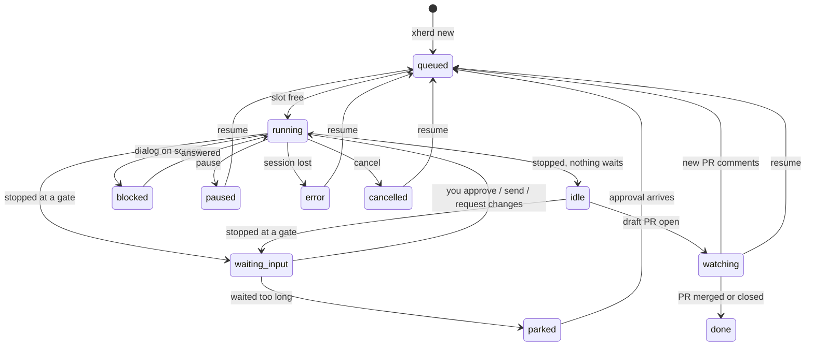

# Getting started

How to install xherd from a published release, start it, and run a first agent. We recommend **Docker**: agents, toolchains and Claude Code stay in a container and only your workspace folder is shared with the host. See [Docker](docker.md) for details and troubleshooting.

To build xherd yourself (an unreleased branch, or to change it), see [Running from source](from-source.md).

## Choose how to run it

| | Docker (recommended) | Native (Linux) |
|---|---|---|
| What you install | A container engine with Compose: Docker Desktop, OrbStack, Colima or Docker on Linux | The `xherd` package, plus `git`, `tmux` ≥ 3.3, Claude Code (or opencode, or Codex) and `gh` / `glab` |
| Agent CLI and tools | In the image (Claude Code, `git`, `gh`, `glab`, toolchain managers) | Yours, on `PATH` |
| Isolation | Agents see only the workspace folder | None: agents run as you |
| Platforms | macOS and Linux (amd64, arm64) | Linux (x86_64, arm64) |

macOS binaries are not published yet ([roadmap](../ROADMAP.md)): on a Mac, use Docker.

xherd is a single-user tool: one person, one daemon, one workspace folder.

### Why Docker first?

Coding agents run commands on your machine, install toolchains and write files. In a container that has limits:

- **Containment.** Agents see only the workspace folder you share, not your home directory, keys or other projects. A confused or misled agent has a small blast radius.
- **Nothing to install.** `git`, `tmux`, `gh`, `glab`, Claude Code and the Java/Node/Go/Rust/Python toolchain managers come in the image, at tested versions. Setup is the same on every machine.
- **Safe to throw away.** Updating is pulling a new image; a broken toolchain is a rebuilt container, not a repaired laptop.
- **Your IDE still works.** The workspace is mounted at the same path inside and outside, so worktrees open directly in your editor.

## Versions

Releases are listed at <https://github.com/xionjames/xherd/releases>. Each one publishes the image `ghcr.io/xionjames/xherd` (amd64 and arm64, tagged `latest`, `X.Y` and `X.Y.Z`) and the Linux binaries (`.tar.gz`, `.deb`, `.rpm`, each with a `.sha256` file).

## Run with Docker

You need only a container engine with Compose. Nothing else goes on your machine.

### 1. Get the compose file

Make a folder for it (any name; `~/xherd-docker` here) and the workspace your agents will work in, then download the compose file of the latest release and write your values beside it:

```sh
mkdir -p ~/xherd-docker ~/xherd
cd ~/xherd-docker
curl -fLO https://github.com/xionjames/xherd/releases/latest/download/compose.yaml
printf 'XHERD_WORKSPACE=%s/xherd\nXHERD_UID=%s\nXHERD_GID=%s\n' "$HOME" "$(id -u)" "$(id -g)" > .env
```

The `.env` values:

- `XHERD_WORKSPACE` must be an absolute path. It is mounted at the **same path** inside the container, so git worktrees stay valid on both sides and your IDE can open them directly. Repositories the agents work on are cloned into it.
- `XHERD_UID` / `XHERD_GID` are your ids: agents write files as you.
- `XHERD_PORT` (optional, default 4740) changes the port on your machine.
- `XHERD_IMAGE` (optional, default `ghcr.io/xionjames/xherd:latest`) stays on one version, for example `ghcr.io/xionjames/xherd:0.1.0`.

To forward your SSH agent (Docker Desktop, OrbStack), uncomment the marked line in `compose.yaml`.

### 2. Start it

```sh
docker compose up -d        # or: docker-compose up -d
```

Open <http://127.0.0.1:4740/>. The port is published on your machine's loopback only, so nothing on your network can reach it. The [Welcome](#first-run) screen opens.

### Everyday operation

Run these in the folder of `compose.yaml`.

| Task | How |
|---|---|
| Logs | `docker compose logs -f` |
| Restart | `docker compose restart`: agents waiting at a gate are parked, the others resumed |
| Stop | `docker compose down` (the volumes and the workspace stay) |
| `xherd` commands | `docker exec -u xherd-daemon xherd xherd ls`, see [Everyday CLI](#everyday-cli) |

### Update

Pause your agents (the Herd's **Pause all**), then:

```sh
docker compose pull && docker compose up -d
```

and resume them. Your configuration, logins, toolchains and agents live in the volumes and the workspace, so they survive the new container. Take a backup first if you care about the agents' state: Settings → Backups.

## Run natively on Linux

Download the package for your machine from the [releases page](https://github.com/xionjames/xherd/releases) and check it against its `.sha256` file (`sha256sum -c <file>.sha256`), then install one of:

```sh
sudo apt install ./xherd_<version>_amd64.deb                      # Debian, Ubuntu
sudo dnf install ./xherd-<version>-1.x86_64.rpm                   # Fedora, RHEL
tar -xzf xherd-<version>-x86_64-unknown-linux-musl.tar.gz \
  && sudo install xherd-<version>-x86_64-unknown-linux-musl/xherd /usr/local/bin/   # any Linux
```

(arm64: `arm64` / `aarch64` in the names.) The binary is static and has the web UI built in. The packages pull in `git` and `tmux`; with the tarball, install them yourself (`tmux` ≥ 3.3).

You also need:

- **Claude Code**, installed and logged in (`claude`, then `/login`, once).
- **`gh`** (GitHub) or **`glab`** (GitLab) for pull requests, logged in. Settings → Git access can also hold a token per host.
- The toolchains your repositories need: natively xherd uses what is on your `PATH` and installs nothing.

Start the daemon and install the xherd commands into Claude Code once:

```sh
xherd daemon            # keep it running (a terminal, tmux, or your own service)
xherd install           # in another terminal: the /xherd:* commands for Claude Code
```

Open <http://127.0.0.1:4740/>.

Data lives in `XHERD_HOME`, else `$XDG_DATA_HOME/xherd`, else `~/.local/share/xherd` (`config.json` there holds the port and the token the CLI uses). Worktrees go to `<workspace>/worktrees/<repo>/<agent>`; the workspace is `config.workspace`, else `$XHERD_WORKSPACE`, else `~/xherd`.

To update, install the newer package and restart `xherd daemon`.

## First run

1. **Welcome** (opens by itself the first time). It walks you through the setup checks, the Claude Code login (in a browser terminal) the commit identity and git hosts. Settings → Git access has both again: the identity, and HTTPS tokens or SSH keys per host.
2. **Setup checks** must pass before you can create agents. Each failing check shows the fix.
3. **Create an agent** from the UI (**New agent**) or the CLI:

   ```sh
   xherd new PROJ-123 --repo https://github.com/you/project "Add login with passkeys"
   ```

   `--repo` takes a URL (cloned once into `<workspace>/repos/`) or a local path (in Docker, one inside the workspace). Other flags: `--slug`, `--flow`, `--base`, `--autonomy`.

## What happens to an agent



*`waiting_input` is shown as `waiting-input` in the UI and API; pause and cancel also apply from the other live statuses.*

The built-in `feature` flow goes through these stages, each ending in a gate where the agent stops:

| Stage | Gate | You review |
|---|---|---|
| spec | `spec.md` | What will be built |
| design | `design.md` | How |
| tasks | `tasks.md` | Task list with a `verify:` command each |
| implement | commit proposal | The diff of exactly the proposed files; xherd makes the commit when you approve |
| review | `review.md` | Findings; must-fix ones become tasks and loop back |
| ship | `pr.md` | The branch as it will be pushed; the agent then opens a draft PR |
| pr-review | `pr-review.md` | Decisions on PR comments (fix, reply, skip); always human-only |

Approvals are by content hash: you approve exactly what you read, and editing an approved document re-opens its gate. Every step starts a **fresh session**; a short `memory.md` carries over what the next step needs.

## Everyday CLI

In Docker, prefix these with `docker exec -u xherd-daemon xherd` (for example `docker exec -u xherd-daemon xherd xherd ls`); for a terminal or your IDE, use the agent page's Terminal tab and **Open in** menu instead of `attach`, `shell` and `open`.

| Command | Does |
|---|---|
| `xherd ls` | Agents, with the open gate or the PR URL |
| `xherd diff <agent>` | What you are being asked to approve |
| `xherd approve <agent>` / `xherd changes <agent> "<comment>"` | Approve or ask for revisions |
| `xherd send <agent> "<text>"` | Type into the agent's session (also answers a question gate) |
| `xherd pause\|resume\|cancel <agent>` | Lifecycle; `xherd pause --all` stops every agent at once |
| `xherd attach <agent>` / `xherd shell <agent>` | Terminal in the agent's session / worktree |
| `xherd open <agent>` | Open the worktree in your IDE (apps from `~/.config/xherd/open.json`, else editors on `PATH`) |
| `xherd autonomy <agent> <level>` | What xherd may approve by itself |
| `xherd backup create` | Archive of the agents and their work |
| `xherd security check` | Exposure overview: binding, plugins, limits |

The UI shows the same, plus the terminal, documents, findings and settings. The full list is in the [CLI reference](cli.md).

## Autonomy

By default every gate waits for you (`ask`). `xherd new --autonomy`, the agent page, or the config `autonomy` key lets xherd approve routine gates itself. Critical gates, the ship gate of a hotfix and `pr`-role stages are always human-only. Tripwires (secrets in a diff, sensitive paths, oversized diffs, a run limit of consecutive auto-approvals) hold a gate for you whatever the level. Auto-approvals are listed under **Needs attention**.

## Next

- [Docker setup](docker.md): topology, the two users in the container, git access, toolchains
- [Configuration](configuration.md) and [CLI reference](cli.md)
- [Security model](security.md)
- [Add xherd support to your SDD](integrate-your-sdd.md)
- [Running from source](from-source.md) and [Development](development.md), to build or change xherd
