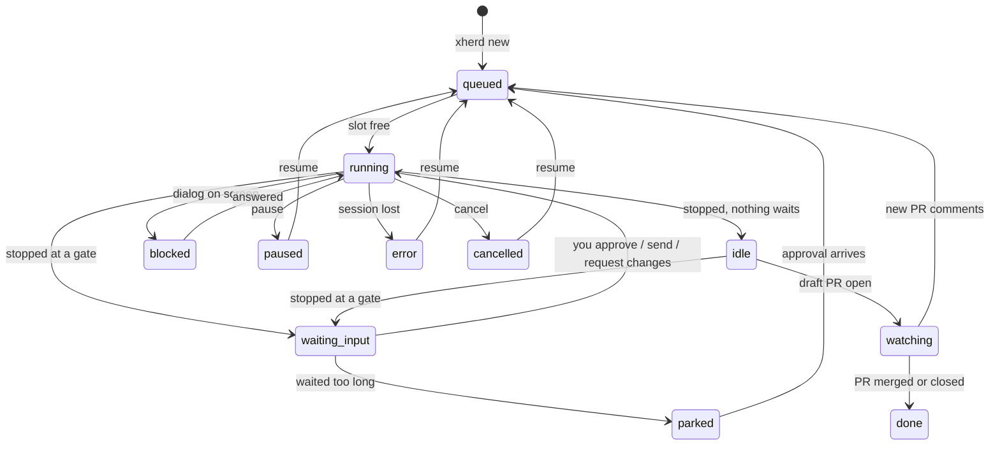

# Getting started

How to install and run xherd, and what a first agent looks like. We recommend **Docker**: agents, toolchains and Claude Code stay in a container and only your workspace folder is shared with the host. See [Docker](docker.md) for details and troubleshooting.

## Requirements

| | Docker (recommended) | Native |
|---|---|---|
| Needed on the host | Docker (Docker Desktop, Colima, OrbStack or Linux Docker) with Compose | Rust toolchain, Node + pnpm, `git`, `tmux` ≥ 3.3 |
| Agent CLI | Installed in the image (Claude Code) | `claude` installed and logged in |
| Forges | `gh` / `glab` in the image | `gh` / `glab` on `PATH` |

xherd is a single-user tool: one person, one daemon, one workspace folder.

### Why Docker first?

Coding agents run commands on your machine, install toolchains and write files. In a container that has limits:

- **Containment.** Agents see only the workspace folder you share, not your home directory, keys or other projects. A confused or misled agent has a small blast radius.
- **Nothing to install.** `git`, `tmux`, `gh`, `glab`, Claude Code and the Java/Node/Go/Rust/Python toolchain managers come in the image, at tested versions. Setup is the same on every machine.
- **Safe to throw away.** Updating is `xherd docker update`; a broken toolchain is a rebuilt container, not a repaired laptop.
- **Your IDE still works.** The workspace is mounted at the same path inside and outside, so worktrees open directly in your editor.

Native works too (no isolation, you manage the tools yourself), and is what you want when developing xherd. See [Docker](docker.md) for the two-user layout and security details.

## Run with Docker

From a clone of this repository:

```sh
cd deploy/compose
printf 'XHERD_WORKSPACE=%s/xherd\nXHERD_UID=%s\nXHERD_GID=%s\n' "$HOME" "$(id -u)" "$(id -g)" > .env
mkdir -p ~/xherd
docker compose up -d --build        # or: docker-compose up -d --build
```

Open <http://127.0.0.1:4740/>. The port is published on the host's loopback only.

- `XHERD_WORKSPACE` must be an absolute path. It is mounted at the **same path** inside the container, so git worktrees stay valid on both sides and your IDE can open them directly.
- `XHERD_UID` / `XHERD_GID` are your ids: agents write files as you.
- `XHERD_PORT` (optional, default 4740) changes the published port.

Day-to-day commands once the container is up (`xherd` on the host is optional; without it use `docker exec`):

```sh
xherd docker doctor     # engine, mounts, ownership, SSH agent, port binding, each finding with a fix
xherd docker update     # pause live agents, pull and restart the container, resume them
```

## Run natively

```sh
export PATH=/opt/homebrew/opt/rustup/bin:$PATH        # macOS Homebrew rustup; adjust to your install
(cd ui && pnpm install && pnpm build)                 # the UI is embedded in release builds
cargo build --release
XHERD_HOME=~/.local/share/xherd ./target/release/xherd daemon
```

Debug builds serve `ui/dist` from disk, so after `pnpm build` a page reload is enough. During UI work use `cd ui && pnpm dev` (Vite dev server that proxies `/api` to the daemon).

Data lives in `XHERD_HOME`, else `$XDG_DATA_HOME/xherd`, else `~/.local/share/xherd`. `config.json` there holds the port, the tmux socket and the user token the CLI uses. Worktrees go to `<workspace>/worktrees/<repo>/<agent>`; the workspace is `config.workspace`, else `$XHERD_WORKSPACE`, else `~/xherd`.

## First run

1. **Welcome** (opens by itself the first time). It walks you through the setup checks, the runtime login (Claude Code, in a browser terminal) and git access. Settings → Git access takes HTTPS tokens or SSH keys per host and a commit identity.
2. **Setup checks** must pass before you can create agents. Each failing check shows the fix.
3. **Install the xherd commands** into the runtime. In Docker this happens at every daemon start; natively run `xherd install` once.
4. **Create an agent** from the UI (New agent) or the CLI:

   ```sh
   xherd new PROJ-123 --repo https://github.com/you/project "Add login with passkeys"
   ```

   `--repo` takes a local path or a URL (cloned once into `<workspace>/repos/`). Other flags: `--slug`, `--flow`, `--base`, `--autonomy`.

## What happens to an agent



*Condensed from `xherd_core::status::next_status`, the authoritative table (`waiting_input` is shown as `waiting-input` in the UI and API; pause and cancel also apply from the other live statuses).*

The built-in `feature` flow goes through these stages, each ending in a gate where the agent stops:

| Stage | Gate | You review |
|---|---|---|
| spec | `spec.md` | What will be built |
| design | `design.md` | How |
| tasks | `tasks.md` | Task list with a `verify:` command each |
| implement | commit proposal | The diff of exactly the proposed files; xherd makes the commit when you approve |
| review | `review.md` | Findings; must-fix ones become tasks and loop back |
| ship | `pr.md` | The branch as it will be pushed; the agent then opens a draft PR |
| pr-review | `pr-review.md` | Decisions on PR comments (fix, reply, skip); always human-only |

Approvals are by content hash: you approve exactly what you read, and editing an approved document re-opens its gate. Every step starts a **fresh session**; a short `memory.md` carries over what the next step needs.

## Everyday CLI

| Command | Does |
|---|---|
| `xherd ls` | Agents, with the open gate or the PR URL |
| `xherd diff <agent>` | What you are being asked to approve |
| `xherd approve <agent>` / `xherd changes <agent> "<comment>"` | Approve or ask for revisions |
| `xherd send <agent> "<text>"` | Type into the agent's session (also answers a question gate) |
| `xherd pause\|resume\|cancel <agent>` | Lifecycle |
| `xherd attach <agent>` / `xherd shell <agent>` | Terminal in the agent's session / worktree (inside the container when using Docker) |
| `xherd open <agent>` | Open the worktree in your IDE (apps from `~/.config/xherd/open.json`, else editors on `PATH`) |
| `xherd autonomy <agent> <level>` | What xherd may approve by itself |
| `xherd security check` | Exposure overview: binding, plugins, limits |

The UI shows the same, plus the terminal, documents, findings and settings. Everything the UI does goes through the HTTP API (`/api/v1`).

## Autonomy

By default every gate waits for you (`ask`). `xherd new --autonomy`, the agent page, or the config `autonomy` key lets xherd approve routine gates itself. Critical gates, the ship gate of a hotfix and `pr`-role stages are always human-only. Tripwires (secrets in a diff, sensitive paths, oversized diffs, a run limit of consecutive auto-approvals) hold a gate for you whatever the level. Auto-approvals are listed under *To review*.

## Next

- [Architecture](architecture.md)
- [Docker setup](docker.md)
- [Development](development.md)
- [XAP reference](xap.md) and [Add xherd support to your SDD](integrate-your-sdd.md)
