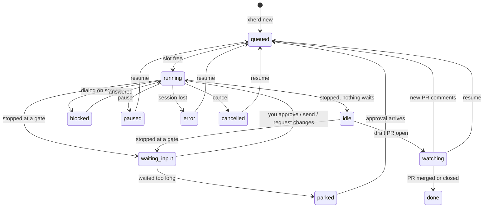

# Using xherd

How to work with xherd once it runs. Installing it is in [Getting started](getting-started.md). Every action here exists in the web UI; most also exist in the [CLI](../reference/cli.md).

## The idea

You give xherd a ticket. It creates an **agent**: a git worktree and a branch for that ticket, a coding runtime (Claude Code, opencode or Codex) in a tmux session, and a `.xherd/` folder with the agent's documents. The agent follows a **flow** of stages and stops at **gates**, where you read what it proposes and approve it or ask for changes. Many agents run in parallel, and the UI shows which ones need you.

## Screens

| Screen | What it is for |
|---|---|
| **Herd** (home) | Every agent: status, stage, progress, tasks. Agents waiting for you are on top. *By stage* puts them in columns by the role of their current stage. *Pause all* is the kill switch |
| **Agent page** | One agent: the your-call band on top, then tabs (below) |
| **Board** | Every stage and task of every agent as cards in Pending / In progress / Done, plus your TODOs. Swimlanes by agent or repository, filters for one agent, one repository, or only what needs you |
| **Needs attention** (✋ and a count in the bar) | Agents waiting for you, TODOs that are due, and approvals xherd made for you that you have not looked at |
| **TODOs** | Reminders and condition checks (below) |
| **Time** | Agent time and your time per day and ticket, cycle time, review rounds and rework |
| **Settings** | General, Gates & autonomy, Notifications, Open in, Git access, Repo profiles, Backups, Plugins, About |
| **Setup checks** | What must be in place before agents can run, each failing check with its fix |

⌘K (Ctrl+K) jumps to an agent by name. The bell in the bar keeps the latest notifications.

## Welcome, plugins and git access

The **Welcome** screen opens by itself the first time, in six steps: Welcome, Plugins, Commit identity, Git access, Connect & check, Ready. Everything it sets is in Settings later.

**Plugins** (Welcome step 2 and Settings → Plugins show the same view) lists the plugins that are on under *Enabled* and the others under *Available*, each grouped by kind: coding agents, Git providers, issue trackers, languages. A search box filters them by name, description or kind. Each card has a switch, its state (Off, Ready, Not ready with the first failing check, Not logged in), *Log in* when the plugin has a login, and *Options*, which opens the plugin's settings, checks, login terminal and, for a language, its versions in a dialog; the cards do not move. In Settings the open dialog is in the URL (`#/settings?tab=plugins&plugin=github`). One coding agent and one language must stay on; Git providers and issue trackers may all be off. In Welcome an enabled plugin that is not logged in (Claude Code, GitHub) holds the step until you log in or switch it off. When a login ends, the checks run again.

**Git** has two parts. *Commit identity* and *Git access* are how git commits, fetches and pushes, for any host. A **Git provider** plugin (GitHub through `gh`, GitLab through `glab`) is the optional, host-specific part: pull requests, comments, logins. A provider that is on and logged in also gives git access for its own host with nothing more to set: GitHub, logged in, covers `github.com` through `gh`. Git access shows such a row marked *From the GitHub plugin*, with its check result; it is never saved, *Edit* turns it into an ordinary row you change, and a row you save for the same host replaces it. Switching the provider off removes it. When xherd runs natively, such a row is not written to xherd's gitconfig, so your own git setup for that host is left alone; save it as a row (*Edit*) if you want xherd to set its credential helper. With no provider on and no hosts, configure access by hand (an SSH key or a token per host) or switch a provider on.

**Connect & check** runs the setup checks again each time you enter it, so a login done in an earlier step shows at once.

## Creating an agent

**New agent** (or `xherd new`) asks for:

- the **ticket key** (`PROJ-123`) and what to do (the prompt);
- the **repository**: a path inside the workspace, or a URL, cloned once into `<workspace>/repos/<host>/<path>` and fetched before each later use;
- optionally the **base branch**, the **flow** (`feature`, or `none` for a plain session with your prompt and no gates), the **autonomy**, the **tool permissions**, the **runtime** and its **model**.

A [repo profile](#repo-profiles) that matches the repository fills in its defaults. If more agents are live than `maxConcurrentAgents`, the new one waits in *queued*.

## The feature flow

The built-in `feature` flow goes through these stages. Each ends at a gate where the agent stops:

| Stage | Gate | You review |
|---|---|---|
| spec | `spec.md` | What will be built |
| design | `design.md` | How. Skipped when the approved spec says `design: skip` in its frontmatter (a small change) |
| tasks | `tasks.md` | The task list, each task with a `verify:` command |
| implement | a commit proposal, per task or group of tasks | The diff of exactly the proposed files. xherd makes the commit when you approve |
| review | `review.md` | The agent's own review. Must-fix findings become tasks and loop back to implement |
| ship | `pr.md` | The branch as it will be pushed, and the PR text. The agent then pushes and opens a **draft** pull request |
| pr-review | `pr-review.md` | Its decision on each new PR comment (fix, reply, skip). Always yours to approve |

Every stage starts a **fresh session** of the runtime. What carries over is `.xherd/spec/memory.md` (state, decisions, a code map, things to watch out for), which each step reads first and rewrites before its gate.

## Gates and reviews

When an agent stops at a gate, the **your-call band** on its page says what it waits for, with **Approve** and **Request changes** on the tab that holds what you approve.

- **Documents** (the *Spec* tab) render Markdown, with Mermaid diagrams drawn. Click any block, or a list item, to comment on it. Questions the agent lists under `## Open questions` get an answer box each. After a change request, the blocks that changed since you read them are marked.
- **Changes** shows diffs. Click a line number to comment on that line. Mark files *Viewed* as you go; a file whose diff changes is un-marked. `.md`, `.html` and image files of the commit being approved have a *Preview*. A new or changed file over 8 MiB that is not committed yet (a heap dump, a build artefact) is listed with its size but not read.
- **Send N comments** sends every comment, from documents and diffs, as one change request.
- **Approve** covers exactly what you read: the UI sends the hash of what it showed, and if a file changed since, the approval is refused. Editing an approved document re-opens its gate.
- At a commit gate you can edit the commit message before approving. If git refuses the commit (a hook fails), the agent is asked to fix it.

A gate can be **held** for you whatever the autonomy level: a secret in the diff, a file too large to scan for secrets (over 8 MiB), a sensitive path, a diff over `maxDiffLines`, a failing lint or test command of the repo profile, open questions, or open review findings. The band says why.

If the agent asks a question (`xherd ask`), the band shows it with an answer box; your answer is typed into its session.

### Other tabs

| Tab | Shows |
|---|---|
| Terminal | The live session. Type into it. Selecting text needs Shift+drag (Option+drag on a Mac) because the runtime takes the mouse |
| Tasks | Tasks with status, evidence and dependencies; tasks from a review or PR round are tagged |
| Commits | Proposed and made commits, with message and files |
| Ticket | The ticket and its comments, read from the tracker, and posting a summary (below) |
| Pull request | State, checks (with links to the runs), conflicts, reviewers, and the PR comment round |
| Shared memory | A proposed update of the repository's `AGENTS.md` (below) |
| Activity | The agent's event log |

## Agent states

*`waiting_input` is `waiting-input` in the UI and API; pause and cancel also apply from the other live statuses.*

- **Parked**: an agent that waits at a gate longer than `gateParkMinutes` frees its slot. Approving it still works: it gets a fresh session with the next command.
- **Blocked**: the runtime shows a permission prompt or dialog. Open the terminal and answer it. A git authentication failure also blocks an agent with the reason *git access*; the band shows the git doctor's first failure and its fix.
- **Pause** asks the agent to write a handoff note (`.xherd/HANDOFF.md`) and ends the session once it has, or after `pauseTimeoutSec`. **Resume** starts a fresh session from that note. **Pause all** (or `xherd pause --all`) stops every agent at once, without notes.
- **Cancel** ends the session at once. The worktree stays, and the agent can be resumed.
- After a restart of the daemon or the container, agents at a gate are parked and the others resumed. A session that dies while the daemon runs is resumed up to twice an hour, then stays in *error*.

## Autonomy

By default every gate waits for you (`ask`). With `important`, xherd approves *routine* and *code* gates itself (design, tasks, review, commits) and leaves *critical* ones (spec, ship) and *human-only* ones (pr-review) to you. Set it per agent at creation (`--autonomy`), later on the agent page (`xherd autonomy`), per repository in a profile, or as the default in Settings → Gates & autonomy.

Held gates are never auto-approved, nor is a gate xherd inferred because the agent stopped without declaring one. After `maxAutoApprovalsInRow` automatic approvals in a row (default 10), the next gate waits for you. Automatic approvals are listed under **Needs attention** until you mark them seen.

**Tool permissions** are separate: they say what the runtime may do without asking. `ask` asks before each tool that needs permission, `edits` (default) accepts file edits, `auto` lets the runtime's own checks decide, `all` asks nothing (only in the container). A change applies from the agent's next session.

The **model** is the runtime's: leave it empty for the runtime's own default, pick a suggestion (Claude Code offers `opus`, `sonnet`, `haiku`) or type any name the runtime knows (opencode takes `provider/model`). The default per runtime is in Settings → Plugins → the runtime's Options, a repo profile can set its own, and the agent page changes it for the agent's next session.

## Pull requests

Approving the ship gate tells the agent to push its branch and open a draft PR; xherd itself never pushes. The agent then goes to *watching*:

- Every `prPollMinutes` (default 5) xherd reads the PR's state, checks, mergeability and reviewers. You are notified when checks start failing, pass again, or the branch conflicts with its base. A merged or closed PR finishes the agent (*done*).
- New review comments start a **PR round**: the agent reads them (as untrusted text), decides per comment (fix, reply, skip) and stops at the `pr-review` gate. Its *Your call* band and ✋ point at the *Pull request* tab (the plan file is not listed under Spec while you decide): each comment shows the agent's choice, coloured on its edge (fix, reply, skip), and you can change any of them. **Send decisions to the agent** (at the bottom of the comments, or in the band) approves the round: it posts the replies, then the agent makes the fixes as tasks, pushes and goes back to watching.

GitHub works through `gh`, GitLab through `glab`. Bitbucket has git access only, no pull request support yet. With no Git provider on, xherd neither looks up nor follows pull requests.

## Tickets

With a tracker plugin on (Jira through `acli`, GitHub issues, GitLab issues), ticket keys in documents become links, and the *Ticket* tab reads the ticket and its comments. Once the PR is open, the agent page offers to post a summary on the ticket: xherd drafts it from the finished tasks, commits and the PR, you edit it, and it is posted only when you click *Post to the ticket*.

## Shared memory

During review, an agent may propose an update of the repository's `AGENTS.md` (what later agents should know about the code). The *Shared memory* tab shows the diff and lets you edit it. Accepting commits `AGENTS.md` (and a `CLAUDE.md` that imports it, if missing) on the agent's branch; dismissing drops it. A proposal never blocks the flow.

## Repo profiles

Settings → Repo profiles holds per-repository settings, matched by the `origin` URL (`github.com/acme/*`) or by folder: the base branch, autonomy, tool permissions, runtime, a model per runtime, tripwires (`sensitivePaths`, `maxDiffLines`), a per-agent token budget, a **lint command** and a **test command** run at every commit proposal (a failure holds the commit for you), and instructions added to every agent's `instructions.md`. Profiles can be exported and imported as JSON. Field by field: [Configuration](../reference/configuration.md#repo-profiles).

## Limits and budgets

- `maxSessionMinutes` ends a session that runs too long (after a handoff note) and pauses the agent.
- `agentTokenBudget` and `dailyTokenBudget` count tokens from the runtime's transcript after each stop: 80 % notifies, 100 % pauses the agent.
- `maxReviewLoops` holds the review gate after that many review → fix rounds.

## TODOs

TODOs are reminders that are not agents. A TODO is due at a time, once or every N minutes; when it comes due it is notified and shows in Needs attention and on the Board. A TODO with a **condition** ("the PR for PAY-412 is merged") is checked at each interval by a short, read-only run of the default runtime: met, or unclear, makes it due; not met waits for the next check. *Check now* runs it at once.

## Notifications

Every notification (a gate, a blocked agent, an idle one, a failure, a budget or limit, an automatic approval, PR news, new PR comments, a due TODO) goes to the bell, and from there:

- to the browser, once you allow it from the bell;
- to your phone through [ntfy](https://ntfy.sh): Settings → Notifications, server and topic. Messages carry agent names and reasons in plain text, never document or comment contents;
- to the desktop (`osascript` on macOS, `notify-send` on Linux) with `desktopNotifications`, native installs only.

Settings → Notifications → *Which ones* mutes kinds everywhere.

## Opening the code

**Open in** on the agent page opens the worktree in VS Code, Cursor or Zed (and Dev Containers when xherd runs in Docker), or a terminal on your computer. The terminal and your own commands (Settings → Open in) go through `xherd companion`, a small process you run on your computer: it asks you once to confirm each command before running it. From a terminal, `xherd attach`, `xherd shell` and `xherd open` do the same.

## Backups

Settings → Backups (or `xherd backup create`) writes one archive with the database, the configuration (no secrets), and for each unfinished agent its `.xherd/` notes, its commits as a git bundle, its uncommitted changes and untracked files. `xherd docker update` takes one before updating. `xherd backup restore` brings the agents back paused, on this machine or another (`--workspace`, `--map`). Tokens and logins are entered again after a restore.

## Everyday CLI

In Docker, prefix these with `docker exec -u xherd-daemon xherd` (for example `docker exec -u xherd-daemon xherd xherd ls`). For a terminal or your IDE, the agent page's Terminal tab and Open in menu replace `attach`, `shell` and `open`.

| Command | Does |
|---|---|
| `xherd ls` | Agents, with the open gate or the PR URL |
| `xherd new <KEY> --repo <path or URL> "<prompt>"` | Create an agent |
| `xherd diff <agent>` | What you are being asked to approve |
| `xherd approve <agent>` / `xherd changes <agent> "<comment>"` | Approve, or ask for revisions |
| `xherd send <agent> "<text>"` | Type into the agent's session (also answers a question) |
| `xherd pause\|resume\|cancel <agent>` | Lifecycle; `xherd pause --all` stops every agent at once |
| `xherd autonomy <agent> <level>`, `xherd mode <agent> <mode>`, `xherd model <agent> <model>` | Autonomy, tool permissions and model |
| `xherd backup create` | Archive of the agents and their work |
| `xherd security check` | Exposure overview: binding, user split, plugins, limits |

The full list is in the [CLI reference](../reference/cli.md).
