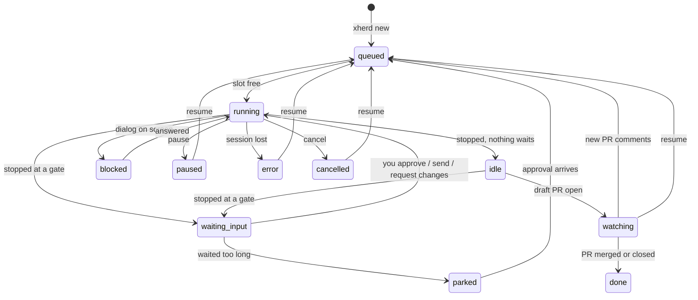

# Using xherd

How to work with xherd once it runs. Installing it is in [Getting started](getting-started.md). Every action here exists in the web UI; most also exist in the [CLI](../reference/cli.md).

## The idea

You give xherd a ticket. It creates an **job**: a git worktree and a branch for that ticket, a coding runtime (Claude Code, opencode, Codex or Pi) in a tmux session, and a `.xherd/` folder with the job's documents. The job follows a **flow** of stages and stops at **gates**, where you read what it proposes and approve it or ask for changes. Many jobs run in parallel, and the UI shows which ones need you.

## Screens

| Screen | What it is for |
|---|---|
| **Jobs** (home) | Four counters that filter (Needs you, Running, Waiting with its breakdown, Done; the same in every layout; click the active one to clear it), then one list grouped *Needs you · Running · Waiting* (done jobs hidden until you ask), newest job first in each group (in *Needs you*, the one waiting longest first). Each job has a **stage track**: one pill per stage of its own workflow, with the stage's name (green done, blue current, coral waits for you, grey not reached, struck through skipped) and the initials of the agent that runs it below. *Team now* on the side shows who is busy with what. *Group* switches the list to Agent or Flow; *Layout* adds *By stage* (the same counters, then columns by current stage, one lane per workflow) and [Herd view plugins](../extend/plugins.md#herd-view-plugins). *Pause all* is the kill switch |
| **Team** | Three tabs. *Agents*: a card per saved setup that jobs start from ([below](#saved-agents)) with status, live jobs, last job, tokens today, *New agent* and *Start job*. *Flows*: which saved agent runs each stage of a workflow ([below](#agents-on-workflow-stages)). *Skills*: the library agents draw from |
| **Job page** | One job: the your-call band on top, then tabs (below) |
| **Board** | Every stage and task of every job as cards in Pending / In progress / Done, plus your TODOs. Swimlanes by job, saved agent, repository or workflow, filters for one job, one repository, or only what needs you |
| **Inbox** (✋ and a count in the bar) | Two panes. Left: *Needs you* in coral (jobs waiting at a gate once the agent has stopped there, a question or a block, and TODOs that are due or whose check failed: only these raise the ✋ and the count), then *Updates*: the approvals xherd made for you that you have not marked seen. Right: the picked item, with its stage track and a button to the tab that holds the decision (`#/inbox`; the old `#/attention` and `#/review` redirect here) |
| **TODOs** | Reminders and condition checks (below) |
| **Time** | Job time and your time per day and ticket, cycle time, review rounds and rework |
| **Settings** | General, Gates & autonomy, Notifications, Open in, Git access, Repo profiles, Backups, Plugins, About |
| **Setup checks** | What must be in place before jobs can run, each failing check with its fix |

The Jobs list can be grouped by status, agent or flow (*Group*, `?group=agent|flow`) and filtered by the counters (`?f=needs|running|waiting|done`, the same in the By stage layout). ⌘K (Ctrl+K) jumps to a job by name or ticket, or to a saved agent by name. The bell in the bar keeps the latest notifications.

## Welcome, plugins and git access

The **Welcome** screen opens by itself the first time, in six steps: Welcome, Plugins, Commit identity, Git access, Connect & check, Ready. Everything it sets is in Settings later.

**Plugins** (Welcome step 2 and Settings → Plugins show the same view) has two views, *Enabled* (the plugins that are on) and *Available* (installed but off), each with a count. A kind filter (agent runtimes, Git providers, issue trackers, toolchains…) and a search box by name, description or kind narrow both; with all kinds shown, cards are grouped by kind. Each card has a switch, its state (Off, Ready, Not ready with the first failing check, Not logged in), *Log in* when the plugin has a login, and *Options*, which opens the plugin's settings, checks, login terminal and, for a toolchain, its versions in a dialog; the cards do not move. In Settings the open dialog is in the URL (`#/settings?tab=plugins&plugin=github`). Once an agent runtime (or a toolchain) is on, the last one cannot be switched off; Git providers and issue trackers may all be off. A first run starts with every plugin off, so enabling them one at a time is fine, and the default runtime moves to the first one you switch on. In Welcome an enabled plugin that is not logged in (Claude Code, GitHub) holds the step until you log in or switch it off. When a login ends, the checks run again. In the container an agent runtime's CLI is installed (and updated to the version xherd was checked against) by xherd itself, at start and when you switch the plugin on: its card says *Installing…* meanwhile, its check has no fix button, and a failed install shows the last lines of its output with *Session* to retry in a terminal. A job for a runtime that is still missing is refused (`runtime_missing`) with where to install it. See [Docker](docker.md#runtime-installs).

**Add plugin** (Settings → Plugins, hidden when installs are off) installs an external plugin from a git URL: enter the URL and optionally a branch, tag or commit, *Preview* it (name, version, `url@sha`, what it will run, a warning), then *Install*. A repository with several plugins asks which one. Installed plugins say *from url@sha*; one copied in by hand says *installed by hand, not pinned*. A plugin's *Options* dialog has *Update* (shows the new version and the manifest diff before applying) and *Remove* (with a box to forget its settings). Plugins load when the daemon starts, so after any of these Settings shows **Restart xherd**; running jobs keep their sessions. The same is `xherd plugin …` and `xherd daemon restart` ([CLI](../reference/cli.md)); read [Security](security.md#plugins) first.

**Git** has two parts. *Commit identity* and *Git access* are how git commits, fetches and pushes, for any host. A **Git provider** plugin (GitHub through `gh`, GitLab through `glab`) is the optional, host-specific part: pull requests, comments, logins. A provider that is on and logged in also gives git access for its own host with nothing more to set: GitHub, logged in, covers `github.com` through `gh`. Git access shows such a row marked *From the GitHub plugin*, with its check result; it is never saved, *Edit* turns it into an ordinary row you change, and a row you save for the same host replaces it. Switching the provider off removes it. When xherd runs natively, such a row is not written to xherd's gitconfig, so your own git setup for that host is left alone; save it as a row (*Edit*) if you want xherd to set its credential helper. With no provider on and no hosts, configure access by hand (an SSH key or a token per host) or switch a provider on.

**Setup checks** include two for the xherd command files of each agent runtime. *xherd commands installed* fails while files are missing or out of date; *Install commands* fixes it (the daemon also does it at every start). *xherd command files reviewed* fails when you have edited a command file the pack now has a new text for, or the pack no longer ships a file you have: *Review files* opens a dialog with one row per file. For an edited file choose *Keep mine* (the default; xherd stops offering that version) or *Use xherd's version* (replaces your edits); for an obsolete file choose *Remove* (default) or *Keep*. The dialog warns when a choice replaces your edits, and one button applies all rows. Nothing you edited is overwritten or deleted without that choice.

After an upgrade xherd also rewrites the hook file and push guard of jobs that are still live, so they call the new binary; your own hook entries are kept.

**Connect & check** runs the setup checks again each time you enter it, so a login done in an earlier step shows at once.

## Creating a job

**New job** (or `xherd new`) asks for:

- a **name** (`refund-retry`: lowercase letters, digits and `-`), which is what the UI shows, the tmux session and the worktree folder, and the **workflow** (`feature`, `bugfix`, or *No workflow* for a plain session with your instructions and no gates; see [Picking a workflow](#picking-a-workflow));
- optionally a **ticket**: an issue URL or a key (`PROJ-123`, `#12`). The form says which tracker reads it; its key starts the branch name (`PROJ-123-refund-retry`), and it shows as a label beside the name. A URL no tracker reads is kept as a link;
- the **repository**: a path inside the workspace, or a URL, cloned once into `<workspace>/repos/<host>/<path>` and fetched before each later use, and optionally the **base branch**. A repository given as a path is fetched from its `origin` before each job too (a failed fetch is only a hint; a repository without `origin` is left alone), and a plain local base branch (`main`) is fast-forwarded to `origin/main` when that is possible: when it is ahead, diverged, dirty or checked out in another worktree it is used as it is. When the ticket is an issue URL a tracker reads, the field fills in the issue's repository (marked "from the ticket") until you type your own, and may stay empty;
- the **instructions** (required with *No workflow*);
- under **More options**: the **autonomy**, the **runtime**, its **model** and the **tool permissions**. Closed, it shows one line with what will apply and whether a profile sets it; it opens by itself once you change one of them, and remembers whether you left it open. With agents on the workflow's stages these four are set by each stage's agent and the form sends none of them; **Override for all stages** brings the controls back.

A [repo profile](#repo-profiles) that matches the repository fills in its defaults; its autonomy and tool permissions are limits (a looser choice is lowered and the job shows a note). A job may start from a saved agent (`POST /api/v1/agents/{id}/jobs`; or `xherd new --agent`, the New job form's Agent picker): the agent's runtime, model, workflow, autonomy, instructions and guardrails apply, the job keeps a snapshot, and the agent's `human` stages are never approved by autonomy. If more jobs are live than `maxConcurrentJobs`, the new one waits in *queued*.

## The feature flow

The built-in `feature` flow goes through these stages. Each ends at a gate where the job stops:

| Stage | Gate | You review |
|---|---|---|
| spec | `spec.md` | What will be built |
| design | `design.md` | How. Skipped when the approved spec says `design: skip` in its frontmatter (a small change) |
| tasks | `tasks.md` | The task list, each task with a `verify:` command |
| implement | a commit proposal, per task or group of tasks | The diff of exactly the proposed files. xherd makes the commit when you approve |
| review | `review.md` | The job's own review. Must-fix findings become tasks and loop back to implement |
| ship | `pr.md` | The branch as it will be pushed, and the PR text. The job then pushes and opens a **draft** pull request |
| pr-review | `pr-review.md` | Its decision on each new PR comment (fix, reply, skip). Always yours to approve |

At the review gate, the findings table has a `fix` or `skip` choice on each open finding. **Fix N findings** sends the choices to the agent, which fixes them and returns to the gate. Approving ships the work; it does not fix open findings.

## The bugfix flow

The built-in `bugfix` flow is for a defect: find the cause, prove it with a failing test, then fix it.

| Stage | Gate | You review |
|---|---|---|
| analysis | `spec.md` and `tasks.md`, one gate | The symptom, steps to reproduce, root cause, fix approach and the test that will reproduce it; the task list (T01 = that test, then the fix tasks). The job changes no repository files here |
| reproduce | a commit proposal with the test only | The new test and, under *Tasks in this commit*, the evidence that it fails today for the reason the analysis gives. When no automated test is practical, the coding agent asks you and goes on without one only if you agree |
| implement (shown as *Fix*) | a commit proposal per fix task | The fix. Each fix task's `verify:` is the reproduction command: xherd runs it, and the task cannot be marked done while it fails |
| review, ship, pr-review | as in the feature flow | The PR text also names the reproduction test and how it failed before the fix |

### Picking a workflow

Use **feature** for new behaviour or a change that needs a spec and a design; **bugfix** when something that should work does not and a test can show it; **No workflow** for a plain session with no documents and no gates. The workflow is chosen when the job is created (`xherd new --flow bugfix`) and stays for its life.

## Sessions and memory

Every stage starts a **fresh session** of the runtime. What carries over is `.xherd/spec/memory.md` (state, decisions, a code map, things to watch out for), which each step reads first and rewrites before its gate.

## Gates and reviews

When a job stops at a gate, the **your-call band** on its page says what it waits for, with **Approve** and **Request changes** on the tab that holds what you approve.

- **Documents** (the *Spec* tab) render Markdown, with Mermaid diagrams drawn. Click any block, or a list item, to comment on it. Questions the coding agent lists under `## Open questions` get an answer box each; once answered, the coding agent removes a question from the section (it reads "None." when none are left), and a section that starts with "None" counts as having no open questions. After a change request, the blocks that changed since you read them are marked.
- **Changes** shows diffs. For a commit waiting for you, the side column starts with *Tasks in this commit*: each task's id, title and the evidence the coding agent gave (for a bug fix, the failing then passing test run); long evidence is cut to two lines, with *Show all* to open it. Below it, the side column lists the files of the diff shown, with their +/− counts and a box that filters the list by path; clicking a file jumps to it (on a phone the list is folded behind *Files (N)* above the diff). Click a line number to comment on that line. A hunk header shows ↑ ↓ ↕ buttons to reveal the unchanged lines around it, 20 per click (↕ shows what is left when 20 or fewer lines remain); revealed lines can be commented too. A file that changed since the diff was read, or is over 2 MiB, cannot be expanded and says why. Mark files *Viewed* as you go; a file whose diff changes is un-marked. `.md`, `.html` and image files of the commit being approved have a *Preview*. A new or changed file over 8 MiB that is not committed yet (a heap dump, a build artefact) is listed with its size but not read.
- **Send N comments** sends every comment, from documents and diffs, as one change request.
- **Approve** covers exactly what you read: the UI sends the hash of what it showed, and if a file changed since, the approval is refused. Editing an approved document re-opens its gate.
- At a commit gate you can edit the commit message before approving. If git refuses the commit (a hook fails), the job is asked to fix it.

A gate can be **held** for you whatever the autonomy level: a secret in the diff, a file too large to scan for secrets (over 8 MiB), a sensitive path, a diff over `maxDiffLines`, a failing lint or test command of the repo profile, open questions, or open review findings. The band says why.

If the coding agent asks a question (`xherd ask`), the band shows it with an answer box; your answer is typed into its session.

### Other tabs

| Tab | Shows |
|---|---|
| Terminal | The live session. A green dot after the label means the agent is running (the job's status is *running*), whichever tab is open. Type into it. Selecting text needs Shift+drag (Option+drag on a Mac) because the runtime takes the mouse. With no session, *Ask* (below) |
| Tasks | Tasks with status, evidence and dependencies; tasks from a review or PR round are tagged. Long file lists and evidence are cut to two lines, with *Show all* to open them in place |
| Commits | Proposed and made commits, with message and files. The shared-memory commit shows as `M01`, `M02`…; a commit made on the branch outside xherd (a direct `git commit`, by the agent or by hand) is found when the agent stops and shows as `X01`, `X02`…, marked held (no proposal or approval), with one notification. A commit xherd recorded and then rebased or amended (same subject, same files) keeps its row with the new sha; a shared-memory commit accepted before xherd listed them shows as `M…` |
| Ticket | The ticket and its comments, read from the tracker, and posting a summary (below) |
| Pull request | State, checks (with links to the runs), conflicts, reviewers, and the PR comment round |
| Shared memory | A proposed update of the repository's `AGENTS.md` (below) |
| Activity | The job's event log |

## Actions

An action is a named command you run from the job page: a dev server, a Storybook, the test suite, a demo script. The coding agent registers them (`xherd action add`) as it discovers what the repository needs, and may read their output (`xherd action log`); it can never run, stop or approve one. The job menu lists them under **Services** (long-running) and **Actions** (they end), with a mark for the state that never relies on colour alone.

- **Allow and run.** A command the job registered runs only after you approved it, and the page shows the whole command first. Changing the command or its folder drops the approval. Autonomy never approves or runs an action.
- **Running.** Each action has its own terminal session next to the job's, with `$XHERD_PORT_BASE` set to the first port of the job's block (a dev server should listen on it) and none of the job's tokens. One instance per action: Run, Stop (Ctrl-C, then a kill after 5 seconds) and Restart. Services keep running while a job is parked or watching its PR, and survive a daemon restart; pausing, cancelling or finishing the job, or removing its worktree, stops them. The last 1 MiB of output is kept and shown after the action ends.
- **Save to repo profile.** From an action's page, or from the card a finished job shows for the actions that succeeded, you can write an action to the repository's [profile](#repo-profiles). New jobs for that repository then start with it already approved.
- **Elsewhere.** Herd cards show `▶ n` for n running services, ⌘K lists the current job's actions, and the CLI has `xherd actions`, `run`, `stop` and `attach --action`. `jobActions` and `maxActionsPerJob` in [Configuration](../reference/configuration.md) switch it off or cap it.

## Files in the terminal

The job's agent terminal (not an action's terminal) takes your files and shows the ones the job made.

- **Drop or paste.** Drop files on the terminal, or paste a screenshot or files from the clipboard (Ctrl+V, Cmd+V). They are uploaded in one request, with a progress chip in the terminal's title bar, to `.xherd/uploads/` in the job's worktree, and their paths are typed into the session, each in single quotes, separated by spaces, with no Enter: you add the sentence around them. Pasting text works as before. A refused upload (too large, too many files) shows its reason and types nothing.
- **Names.** The stored name keeps letters, digits, `.`, `_` and `-`, drops a leading `.`, and is numbered (`shot-2.png`) when the name is taken. Uploads are never overwritten and never committed (`.xherd/` is excluded from git) and are not part of a [backup](#backups); they go when the worktree does.
- **Limits.** One file up to 25 MiB, 250 MiB and 200 files per job by default; Settings → General → Uploads changes them at once (a file can be at most 30 MiB).
- **Path links.** An absolute path in the terminal that lies inside the job's worktree is a link: clicking it downloads the file (uploads and anything the job wrote). Other paths stay text; web links work as before.
- **Docker.** The daemon asks the agents' user to write the file, so the job owns what you upload and can read, move and delete it.
- **CLI.** `xherd upload <job> FILE…` prints the stored paths; `xherd download <job> PATH [-o FILE]` fetches a file.

## Job states

*`waiting_input` is `waiting-input` in the UI and API; pause and cancel also apply from the other live statuses.*

- **Parked**: a job that waits at a gate longer than `gateParkMinutes` frees its slot. Approving it still works: it gets a fresh session with the next command.
- **Blocked**: the runtime shows a permission prompt or dialog. Open the terminal and answer it. A git authentication failure also blocks a job with the reason *git access*; the band shows the git doctor's first failure and its fix.
- **Pause** asks the job to write a handoff note (`.xherd/HANDOFF.md`) and ends the session once it has, or after `pauseTimeoutSec`. **Resume** starts a fresh session from that note. **Pause all** (or `xherd pause --all`) stops every job at once, without notes.
- **Ask**: a paused, parked, watching or failed job has a text box in its Terminal tab. Your text starts a session (continuing the last conversation when the runtime finds it) as its first prompt, through the flow pack's `ask` command (`/xherd:ask <text>`): the agent answers a question, and turns a requested change into tasks and commit proposals instead of committing with git (a job with no flow gets the bare text). The agent reads the job's memory and the agent's memory first, and when the exchange settles something lasting it updates the job's `memory.md` and proposes the agent's memory; a plain question changes neither. The session stays open while the job only answers: it is not approved automatically or sent back to *watching*, and you can go on typing in the terminal. A band says so, and **Finish** (in the band, in place of Pause, or `xherd finish`) ends it: back to *watching* when it was watching its PR, else *paused*. If the job starts flow work instead (enters a stage, opens a gate, works on tasks or commits), the hold ends and the usual rules apply. From the CLI: `xherd talk <job> "<text>"`.
- **Cancel** ends the session at once. The worktree stays, and the coding agent can be resumed, unless you tick *Also remove the worktree*.
- **Remove worktree…** (a button on the job page, next to Open worktree in…, for a *done* or *cancelled* job, or `xherd remove-worktree`) deletes the worktree folder, with its uncommitted changes and the spec documents in `.xherd/`. The branch and the job's record (approvals included) stay; the tabs that read the worktree then say it was removed, and the coding agent can no longer be resumed.
- After a restart of the daemon or the container, jobs at a gate are parked and the others resumed. A session that dies while the daemon runs is resumed up to twice an hour, then stays in *error*.

## Autonomy

By default every gate waits for you (`ask`). With `important`, xherd approves *routine* and *code* gates itself (design, tasks, review, commits) and leaves *critical* ones (spec, ship) and *human-only* ones (pr-review) to you. Set it per job at creation (`--autonomy`), later on the job page (`xherd autonomy`), per repository in a profile, or as the default in Settings → Gates & autonomy.

Held gates are never auto-approved, nor is a gate xherd inferred because the job stopped without declaring one. After `maxAutoApprovalsInRow` automatic approvals in a row (default 10), the next gate waits for you. A gate xherd will approve when the job stops does not show as waiting for you meanwhile; if it is held or refused at the stop, it does. Automatic approvals are listed under **Inbox → Updates** (*Approved by xherd*) until you mark them seen; they never raise the ✋.

**Tool permissions** are separate: they say what the runtime may do without asking. `ask` asks before each tool that needs permission, `edits` (default) accepts file edits, `auto` lets the runtime's own checks decide, `all` asks nothing (only in the container). A change applies from the job's next session.

The **model** is the runtime's: leave it empty for the runtime's own default, pick a suggestion (Claude Code offers `opus`, `sonnet`, `haiku`) or type any name the runtime knows (opencode takes `provider/model`). The default per runtime is in Settings → Plugins → the runtime's Options, a repo profile can set its own, and the job page changes it for the job's next session.

## Pull requests

Approving the ship gate tells the job to push its branch and open a draft PR; xherd itself never pushes. The job then goes to *watching*:

- Every `prPollMinutes` (default 5) xherd reads the PR's state, checks, mergeability and reviewers. You are notified when checks start failing, pass again, or the branch conflicts with its base. A merged or closed PR finishes the job (*done*).
- **Check now** in the *Pull request* tab reads the PR at once, whatever the job's state, instead of waiting for the next poll; the next automatic poll then waits a full interval.
- When the PR conflicts with its base, the *Pull request* tab offers **Resolve conflicts** (also `xherd resolve-conflicts <job>`): the job, once it is stopped (watching, paused, idle or in error) with no gate open, starts a clean session that merges the base branch into its branch (never a rebase or force-push), resolves the conflicts, runs the tests and proposes the merge commit. That commit is always held for you, whatever the autonomy; once you approve it, the coding agent pushes the branch and goes back to watching.
- New review comments start a **PR round**: the coding agent reads them (as untrusted text), decides per comment (fix, reply, skip) and stops at the `pr-review` gate. Its *Your call* band and ✋ point at the *Pull request* tab (the plan file is not listed under Spec while you decide): each comment shows the job's choice, coloured on its edge (fix, reply, skip), and you can change any of them. **Send decisions to the job** (at the bottom of the comments, or in the band) approves the round: it posts the replies, then the coding agent makes the fixes as tasks, pushes and goes back to watching.

GitHub works through `gh`, GitLab through `glab`. Bitbucket has git access only, no pull request support yet. With no Git provider on, xherd neither looks up nor follows pull requests.

## Tickets

With a tracker plugin on (Jira through `acli`, GitHub issues, GitLab issues), ticket keys in documents become links, and the *Ticket* tab reads the job's ticket and its comments (from the repository the ticket URL names, when it is a URL). Once the PR is open, the job page offers to post a summary on the ticket: xherd drafts it from the finished tasks, commits and the PR, you edit it, and it is posted only when you click *Post to the ticket*.

## Shared memory

During review, a job may propose an update of the repository's `AGENTS.md` (what later jobs should know about the code). The *Shared memory* tab shows the diff and lets you edit it. Accepting commits `AGENTS.md` (and a `CLAUDE.md` that imports it, if missing) on the job's branch, also after the pull request is open; xherd never pushes, so push the branch to update the PR. Accepting is refused only while the job works. Dismissing drops the proposal. A proposal never blocks the flow. The diff is against `AGENTS.md` as committed at `HEAD`, so an edit a job left in the worktree shows up too. Jobs cannot put `AGENTS.md` or `CLAUDE.md` in a task's commit (xherd refuses the proposal): the only way in is this tab. Jobs are told to keep it small and to record only lasting facts about the code.

## Agents on workflow stages

One job can have an architect for the spec and design, a coder for the implementation and a reviewer for the review. **Flows** (`#/flows`, or `xherd flow`) lists every workflow on the left; the picked one shows a card per stage in order (solid = agent set there, dashed = same as the stage before, ✋ = the gate always waits for you), and the selected stage has an agent picker and a **When it finishes** switch (*Always wait for me*: the gate waits whatever the autonomy). A stage with no agent uses the one the job was started with, else the agent of the stage before; with none at all the job runs as one without agents. Assignments apply to jobs created afterwards.

- A job keeps a snapshot of every agent its stages use, so later edits never change it. At each stage start the job takes that stage's agent: instructions, memory, skills, tool permissions, model and autonomy (a repo profile's ceilings still apply), always in a fresh session. The stepper names the agent of each stage and the header names the current one, with its runtime, model, autonomy and tools as facts; **Override for this job** (header) changes them for this job only and pins it to the current agent, so it stops switching at each stage.
- All agents of one job must use the same runtime (`mixed_runtime` otherwise) until a job can change runtime between steps. An agent may name a **fallback runtime**, used once at creation when its runtime is unusable; the job page says it fell back.
- Choosing a model, tool permissions or autonomy on the job page pins the current agent: later stages keep it.
- **Fresh-context check**: the stage cards of a spec, design or analysis stage (the ones that end at a document gate) have an Off/On switch under **When it finishes**. On, the job hands its documents to a fresh sub-agent that has not seen the conversation, before it opens the gate, and fixes what that reader finds unclear, missing or contradictory. It runs once per gate and costs one extra short agent session, so it is off by default. It applies to jobs created afterwards (a job keeps the setting it started with), the job page marks the stage as checked, and `xherd flow show` lists it. The review always uses a fresh sub-agent when the runtime has one.
- Limits and budgets follow the agent of the current stage. Jobs shows jobs (List, By stage); what each agent is doing is in *Team now* and on the **Team** page, and Board cards name the agent of their stage.

## Saved agents

An **agent** is a named, versioned persona that jobs start from: runtime and model (and a fallback runtime), autonomy, tool permissions, instructions, guardrails (a token budget per job, a diff limit, sensitive paths) and how many of its jobs may be live at once. It has no repository, base branch or workflow: those come from the job, the ticket and the repo profile, and the workflow decides which agent works on which stage. Agents → *New agent* (or `xherd agent new`) creates one; its name cannot change later.

- **Start a job from it**: *Start job*, or the optional **Agent** picker of *New job*, shown only for a job with **No workflow** (the last choice is remembered); with a workflow, agents come from the stage assignments and *Agent per stage*. The picker fills the fields the agent sets and marks them *from agent*; change any of them for this job only. *Agent per stage* shows the agent each stage resolves to and lets you change one for this job. The name may then be left empty: the job is `<agent>-<ticket key>`, else `<agent>-<n>`.
- **Settings** on the agent page edit the form; every save makes a **new version**. The *Versions* tab keeps them all, each with what changed. A job keeps the settings of the version it started with: its page says *agent changed since this job started* and opens the diff.
- A [repo profile](#repo-profiles) still applies: its autonomy and tool permissions are ceilings (the form says so under the field), its sensitive paths are added to the agent's, and the smaller diff limit and token budget win.
- **Archive** hides an agent from pickers and keeps its history; its jobs keep working. **Delete** needs no live job; its jobs keep their settings and show its name as plain text. An agent whose runtime and fallback runtime are both gone or switched off is marked and cannot start jobs until fixed. An agent a workflow stage names cannot be archived or deleted until that assignment changes.
- With **live jobs at once** reached, more jobs of that agent wait in the queue (*waits for its agent*) while others start.
- **Skills** (Team → Skills) are a library of reusable instructions and files: add a folder with a `SKILL.md` or write one, view or delete it (not while an agent lists it). An agent lists skills from this library; each job it starts gets a copy in its worktree, where the job's runtime looks for project skills (Claude Code `.claude/skills`, opencode `.opencode/skills`, Codex `.agents/skills`), hidden from git. A skill the repository already has under that name is left alone, and a runtime with no skill folder skips them: the job page names each skill that was not installed and why. Skills are never pasted into the prompt.
- **Which instruction wins.** The stage's own command (the workflow's prompt for that stage) and xherd's rules (gates, tripwires, the protocol) come first; the agent's instructions say *how* to work (style, conventions) and apply where the stage says nothing. Gates and limits are enforced by xherd whatever an agent says. Between the repository's instructions and the agent's, the agent's come later and win.
- **Memory** (the agent page's Memory tab, up to 4 000 characters) is what every job from the agent should know. A job gets the text as it is when it starts, as an *Agent memory* section of its instructions after the agent's own; changing it later does not reach jobs already started.
- **Agent memory proposals**: at the review a job of an agent may propose a new memory; you accept it (editable) or dismiss it on the job's *Agent memory* tab. Nothing is written without you.
- **Save a setup as an agent**: a job with no agent offers it (a band on its page and one *suggestion* notification, never a pop-up) when it is done, when you **Mark done** a job with no workflow (*⋯ → Mark done*, `xherd done`: such a job has no PR to merge, so nothing else ends it), or when you start the same setup (repository, runtime, model, workflow, autonomy, tool permissions) a third time within 30 days. Not after a cancel or a failure. *Save as agent…* opens a form filled with what the job ran with, a name and description from the repository and workflow, and instructions the job drafted at the ship step from what you had to tell it (ticket and PR text are never used for this). Save creates the agent (version 1) and attaches the job, which keeps its own settings. *Not now* is remembered for that job; *Don't suggest* turns off Settings → Gates & autonomy → *Suggest saving a job's setup as an agent*. *Save as agent…* is always in the job's ⋯ menu, for any job without an agent.

## Repo profiles

Settings → Repo profiles holds per-repository settings, matched by the `origin` URL (`github.com/acme/*`) or by folder: the base branch, autonomy, tool permissions, runtime, a model per runtime, tripwires (`sensitivePaths`, `maxDiffLines`), a per-job token budget, a **lint command** and a **test command** run at every commit proposal (a failure holds the commit for you), instructions added to every job's `instructions.md`, and saved [actions](#actions). Profiles can be exported and imported as JSON. Field by field: [Configuration](../reference/configuration.md#repo-profiles).

## Limits and budgets

- `maxSessionMinutes` ends a session that runs too long (after a handoff note) and pauses the job.
- `agentTokenBudget` and `dailyTokenBudget` count tokens from the runtime's transcript after each stop: 80 % notifies, 100 % pauses the job.
- `maxReviewLoops` holds the review gate after that many review → fix rounds.

## TODOs

TODOs are reminders that are not jobs. A TODO is due at a time, once or every N minutes; when it comes due it is notified and shows in the Inbox and on the Board. A TODO with a **condition** ("the PR for PAY-412 is merged") is checked at each interval by a short, read-only run of the default runtime: met, or unclear, makes it due; not met waits for the next check. *Check now* runs it at once.

## Notifications

Every notification (a gate, a blocked job, an idle one, a failure, a budget or limit, PR news, new PR comments, a due TODO, a suggestion to save an agent) goes to the bell, and from there:

- to the browser, once you allow it from the bell. A newer notice for the same job and kind replaces the earlier one and alerts again (Chrome; Firefox and Safari replace it silently). Browsers only allow notifications on a secure page: open xherd at `http://localhost` or `http://127.0.0.1` (or over https), not at a LAN address over http. When they cannot be turned on, the bell says why. Once on, the bell's **Send a test** shows one at once; if nothing appears, the operating system is holding it back (macOS: System Settings → Notifications → your browser, and Focus / Do Not Disturb), and if the browser refuses it, the bell shows its error;
- to your phone through [ntfy](https://ntfy.sh): Settings → Notifications, server and topic. Messages carry job names and reasons in plain text, never document or comment contents;
- to the desktop (`osascript` on macOS, `notify-send` on Linux) with `desktopNotifications`, native installs only: in Docker the daemon cannot reach your desktop, so Settings does not offer it there; use the browser or ntfy.

Settings → Notifications → *Which ones* mutes kinds everywhere. Automatic approvals send no notification: they are listed under **Inbox → Updates** (*Approved by xherd*).

## Opening the code

**Open worktree in…** on the job page opens the worktree in VS Code, Cursor or Zed (and Dev Containers when xherd runs in Docker), in a terminal on your computer, or through your own links. Every entry is a link your browser opens; worktrees have the same path on your computer and in the container, so they open your local apps on your local files.

**Terminal** opens your own terminal app with the worktree as its folder, so you can build and run the app there. It needs a one-time setup on each computer, in Settings → Open in → *Terminal on this computer*: natively the **Install** button (or `xherd terminal-handler install`); in Docker the `curl … | sh` command shown there, run in a terminal on your computer (no `xherd` needed on it). That registers the `xherd-term://` link for you and keeps nothing running; the entry shows in the menu once the install has told xherd. Choose the terminal app there too (otherwise your desktop's default). Your browser asks before opening each link; Chrome's "Always allow" removes the prompt for that site. When Settings says *Update*, run the install again. On macOS this is not checked on a real Mac yet.

**Your links** (Settings → Open in) add entries for apps with their own URL scheme, for example `idea://open?file={dir}`: `{dir}` is the worktree and `{job}` the job's name. Web links (`http`, `https`…) are refused. The commands of older versions were removed; Settings names them once.

From a terminal, `xherd attach`, `xherd shell` and `xherd open` still work.

## Backups

Settings → Backups (or `xherd backup create`) writes one archive with the database (which holds your saved agents, their versions and memories), the skills library, the configuration (no secrets), and for each unfinished job its `.xherd/` notes, its commits as a git bundle, its uncommitted changes and untracked files. `xherd docker update` takes one before updating. `xherd backup restore` brings the jobs back paused, on this machine or another (`--workspace`, `--map`). Tokens and logins are entered again after a restore.

## Everyday CLI

In Docker, prefix these with `docker exec -u xherd-daemon xherd` (for example `docker exec -u xherd-daemon xherd xherd ls`). For a terminal or your IDE, the job page's Terminal tab and Open in menu replace `attach`, `shell` and `open`.

| Command | Does |
|---|---|
| `xherd ls` | Jobs, with the open gate or the PR URL |
| `xherd new <name> --repo <path or URL> [--ticket <URL or key>] "<prompt>"` | Create a job |
| `xherd diff <job>` | What you are being asked to approve |
| `xherd approve <job>` / `xherd changes <job> "<comment>"` | Approve, or ask for revisions |
| `xherd send <job> "<text>"` | Type into the job's session (also answers a question) |
| `xherd pause\|resume\|cancel <job>` | Lifecycle; `xherd pause --all` stops every job at once; `cancel --remove-worktree` also deletes the worktree |
| `xherd actions <job>`, `xherd run <job> <action> [--approve]`, `xherd stop <job> <action>` | List, run and stop a job's actions |
| `xherd upload <job> FILE…`, `xherd download <job> PATH [-o FILE]` | Send files to a job, or fetch one from its worktree |
| `xherd talk <job> "<text>"` / `xherd finish <job>` | Ask a stopped job something, and end that session |
| `xherd remove-worktree <job>` | Delete a done or cancelled job's worktree (the branch stays) |
| `xherd autonomy <job> <level>`, `xherd mode <job> <mode>`, `xherd model <job> <model>` | Autonomy, tool permissions and model |
| `xherd backup create` | Archive of the jobs and their work |
| `xherd security check` | Exposure overview: binding, user split, plugins, limits |

The full list is in the [CLI reference](../reference/cli.md).
