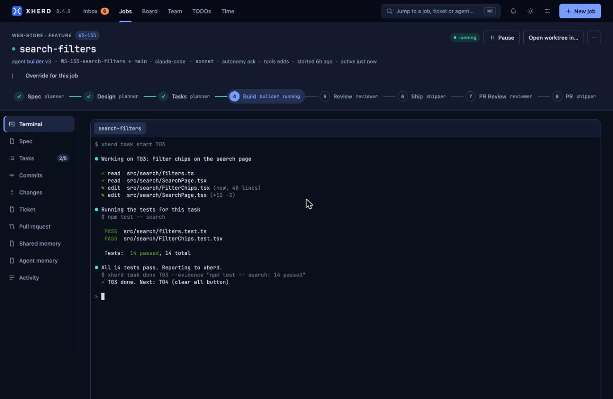
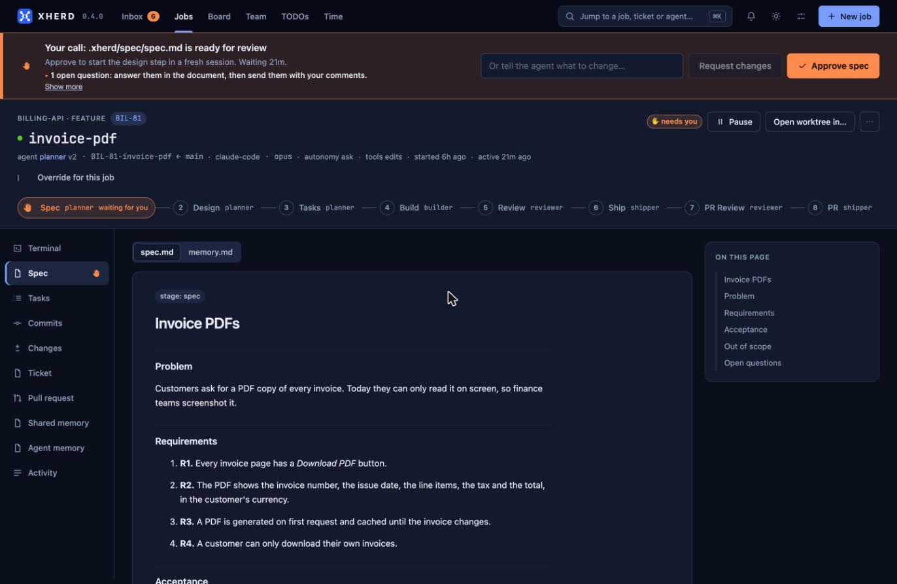
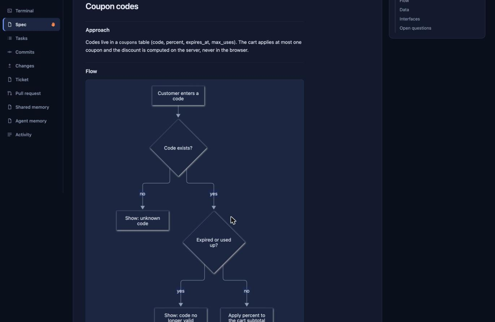
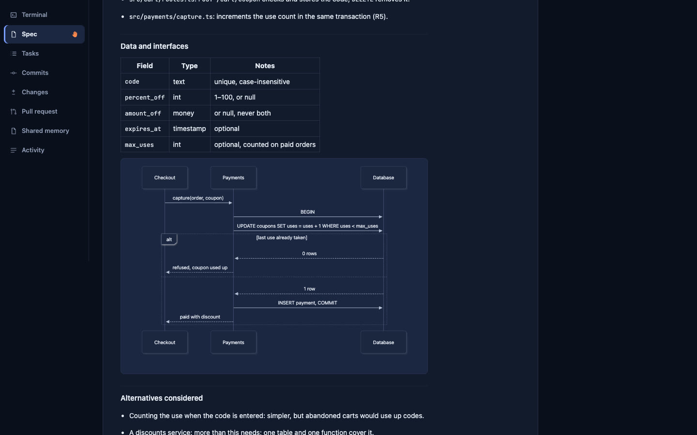
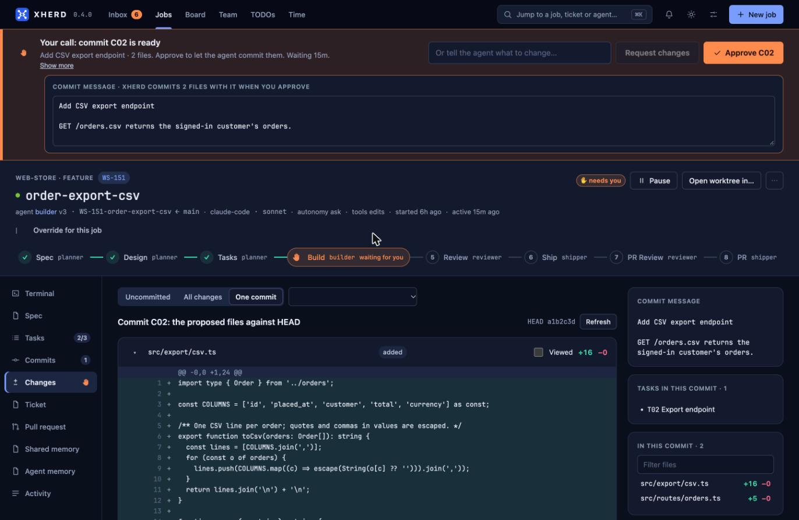
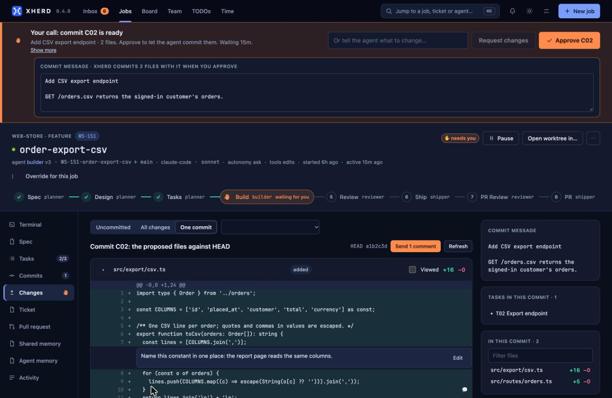
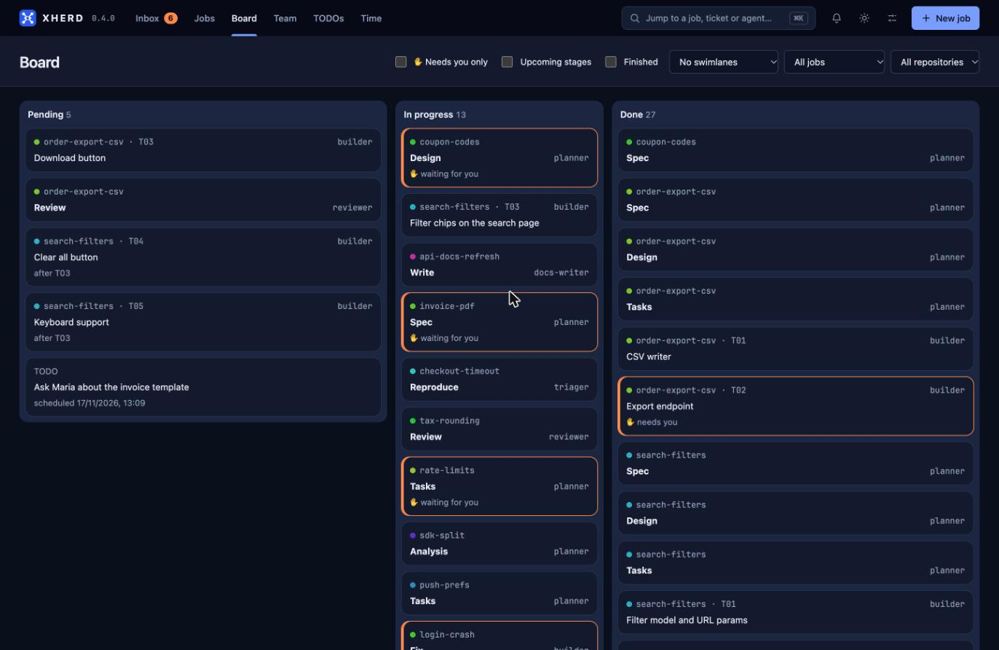
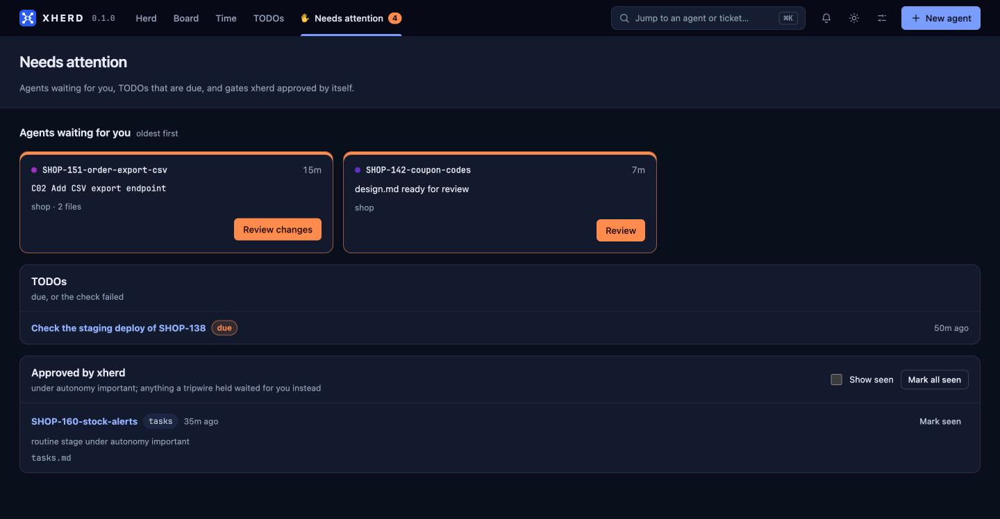
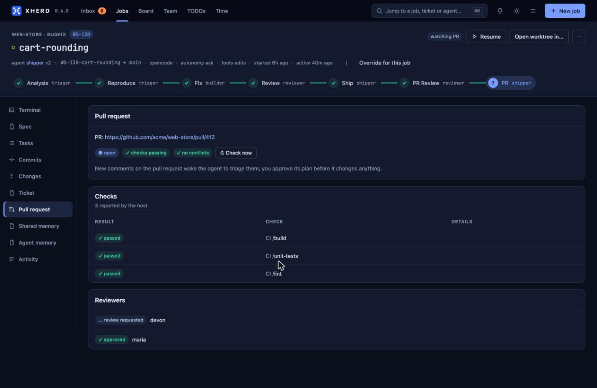
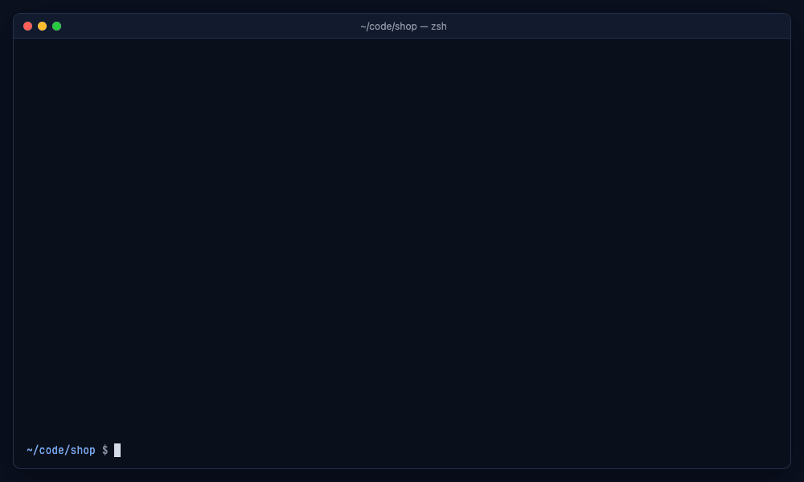

# A tour of xherd

The screens and the CLI, all with mocked data. A short video of the same tour is on the [project page](../../README.md#what-is-xherd); the [user guide](guide.md) explains each screen.

## Screens

| | |
|---|---|
|  |  |
| **Herd.** What needs you on top, every job below. | **Terminal.** Each job's live session, in the browser. |
|  |  |
| **Spec.** Problem, requirements and acceptance, written by the job. | **Review a document.** Approve it, or ask for changes. |
|  |  |
| **Design.** Diagrams in the documents are drawn ([Mermaid](https://mermaid.js.org)). | **Design.** Data, interfaces and the tricky parts, as diagrams. |
|  |  |
| **Review a commit.** xherd commits it when you approve. | **Comment on lines.** Comments go back to the job as one change request. |
|  |  |
| **Board.** Every stage and task of every job, and your TODOs. | **Needs attention.** Everything waiting on you in one place. |
|  | |
| **Pull request.** Checks, conflicts and reviewers, polled while the job watches it. | |

### From the terminal

*The everyday actions are also commands: `xherd ls`, `new`, `diff`, `approve`, `changes`, `pause` (the outputs are real, from a throwaway daemon). See the [CLI reference](../reference/cli.md).*
