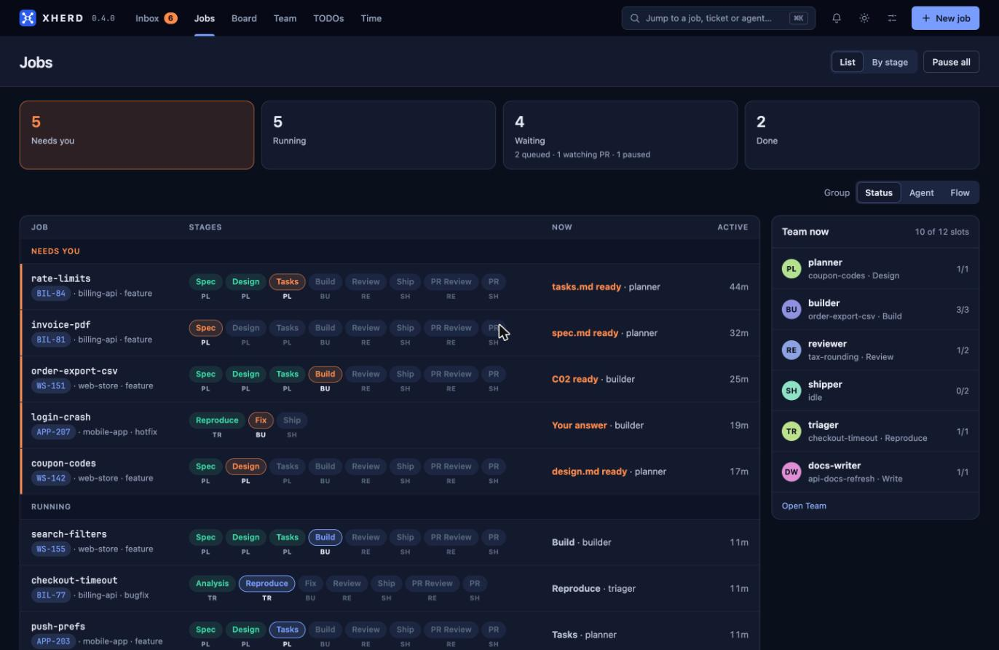
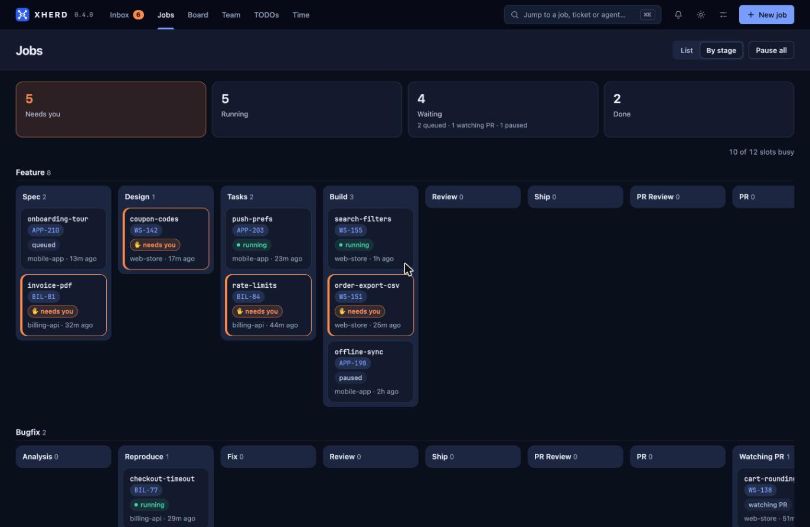
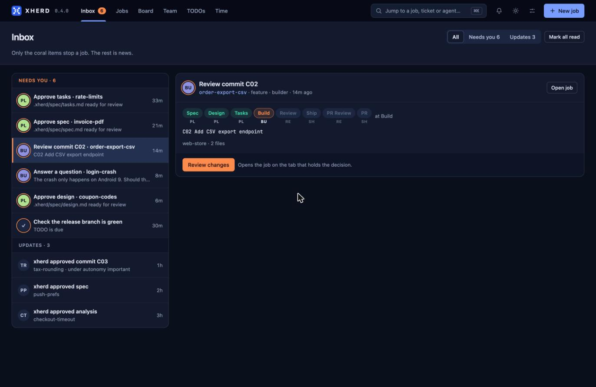
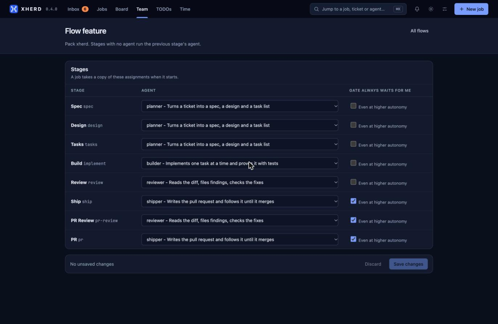
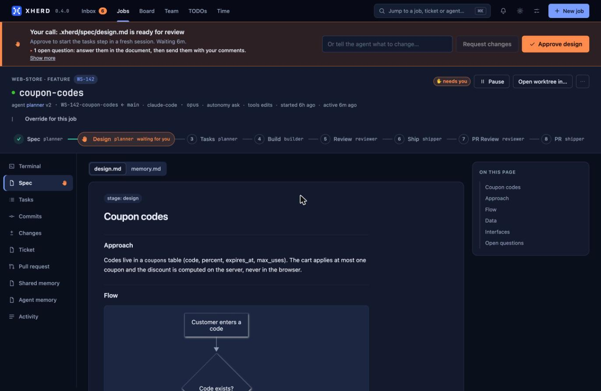
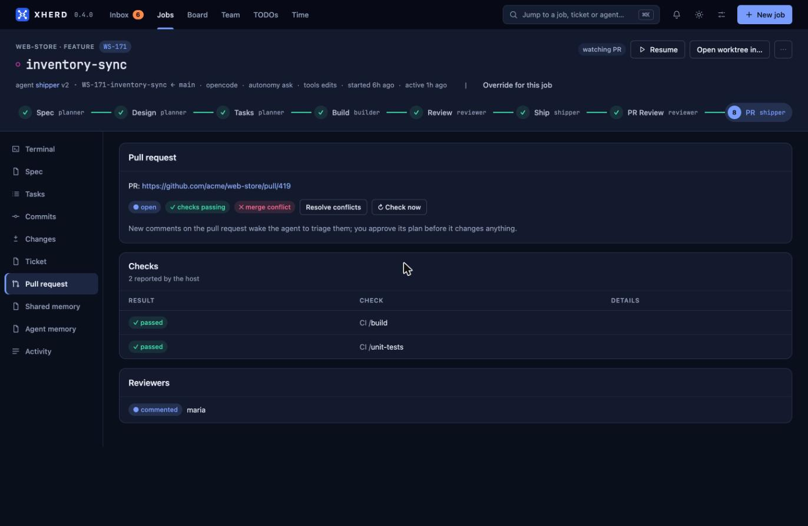

# A tour of xherd

The screens and the CLI, all with mocked data. A short video of the same tour is on the [project page](../../README.md#what-is-xherd); the [user guide](guide.md) explains each screen.

## Screens

| | |
|---|---|
|  |  |
| **Jobs.** What needs you first; a pill per stage, the agent's initials below it. | **Jobs by stage.** One lane per workflow (feature, bugfix…), a column per stage. |
|  |  |
| **Inbox.** Everything that stops a job, and what xherd approved for you. | **Board.** Every stage and task of every job, and your TODOs. |
|  |  |
| **Team.** Saved agents: who they are, what they run on and how busy they are. | **Flows.** Give each stage of a workflow to an agent. |
|  |  |
| **Terminal.** Each job's live session, in the browser. | **Spec.** Problem, requirements and acceptance, written by the agent. |
|  |  |
| **Review a document.** Approve it, or ask for changes. | **Design.** Diagrams in the documents are drawn ([Mermaid](https://mermaid.js.org)). |
|  |  |
| **Review a commit.** xherd commits it when you approve. | **Comment on lines.** Comments go back to the job as one change request. |
|  |  |
| **Pull request.** Checks, conflicts and reviewers, polled while the job watches it. | **Resolve conflicts.** The job merges the base branch; the merge commit always waits for you. |

### From the terminal

*The everyday actions are also commands: `xherd ls`, `new`, `diff`, `approve`, `changes`, `pause` (the outputs are real, from a throwaway daemon). See the [CLI reference](../reference/cli.md).*
